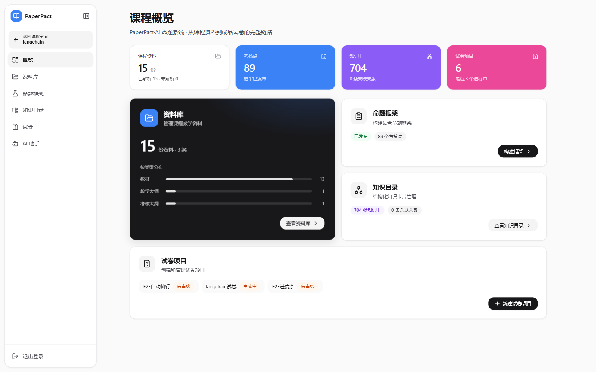
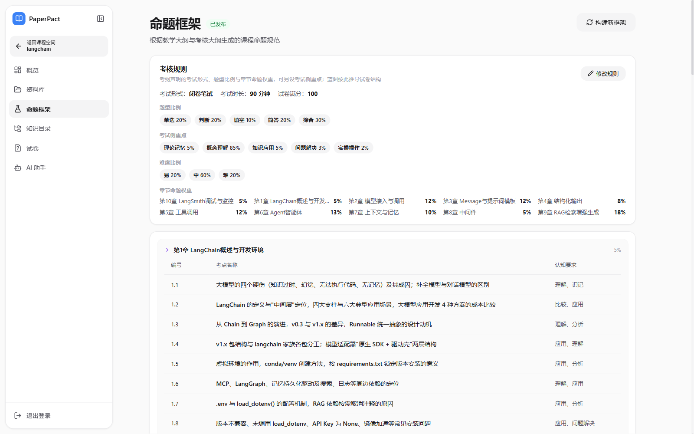
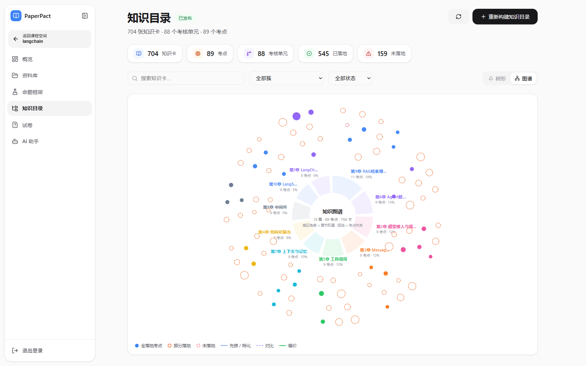
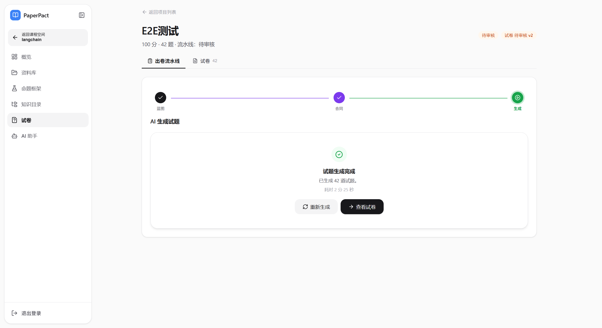
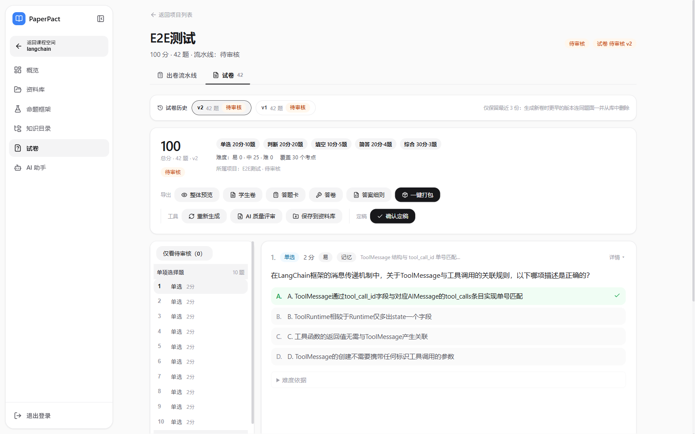
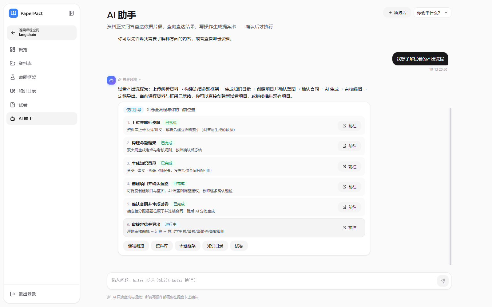
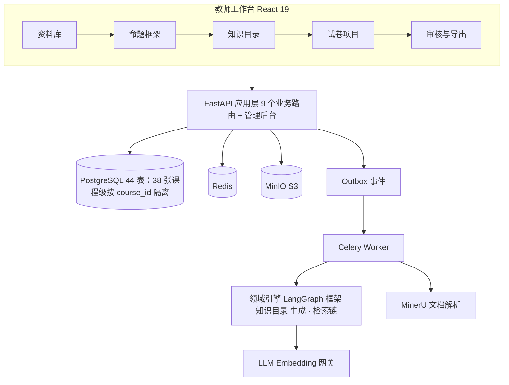

<div align="center">

# PaperPact · AI 命题系统

**把一份课程大纲，变成一套可以直接印刷的期末试卷**

从大纲解析、命题框架、知识目录，到蓝图、合同、AI 生成、教师审核与四类导出，
把「出卷」拆成一条可追踪、可复核、可复现的生产线。

[](https://gitee.com/yan-ace/zhinengchujuanxitong)
[](https://gitee.com/yan-ace/zhinengchujuanxitong)


</div>

## 开发者与实现重点

**个人开发项目，开发者：张新彦。** 面向高校教师，提供资料问答、知识卡构建、试卷生成与审核导出。

| 实现重点 | 代码入口 |
| --- | --- |
| 基于 LangChain 组合关键词与向量检索，并融合候选结果，为资料问答提供来源依据 | [混合检索](backend/app/services/langchain_retrieval.py) |
| 使用 LangGraph 编排分批生成、格式校验与失败重试 | [生成工作流](backend/app/workflows/generation_graph.py) |
| 为 AI 助手接入 16 个工具；按工具配置区分自动执行与教师确认 | [工具注册表](backend/app/services/assistant_tools.py) |

**项目成果：** 2026 全球人工智能算法精英大赛省赛二等奖，获奖证书待发放。

[查看界面](#页面预览) · [阅读系统架构](#系统架构) · [生成工作流测试](backend/tests/workflow/test_generation_graph.py)

## 这是什么

PaperPact 面向高校教师，解决一门课从「有大纲」到「有卷子」之间最耗时的一段工作：

- 读取教学大纲与考核大纲，生成可编辑的命题框架与考核规则
- 把课程资料整理成带证据关系的知识目录，而不是一堆检索片段
- 先生成蓝图与合同，再让 AI 按合同逐题写作
- 教师逐题审核、改题、定稿
- 一键导出学生卷、答卷、答题卡（HTML + DOCX）与答案细则 JSON，并打包档案卡六件套

> 范围边界：系统止于「纸质试卷生产线」的最后一公里，**不包含在线考试与在线阅卷**。导出的答案细则 JSON 是阅卷端的直接输入。

## 页面预览

| 课程概览：资料 / 框架 / 知识目录 / 项目 | 命题框架：大纲 → 考点 → 考核规则 |
| :---: | :---: |
|  |  |
| **知识目录：图谱视图** | **出卷流水线：蓝图 → 合同 → 生成** |
|  |  |
| **试卷审核与一键导出** | **AI 助手：按当前状态给出下一步** |
|  |  |

## 为什么不是「让大模型直接生成一张卷」

直接让模型出卷，通常会在四个地方失控：

- 题量、分值、章节比例和考纲对不上
- 同一考点被反复出题，答案域互相重叠
- 单题失败就整卷重来，成本和稳定性都不可控
- 结果无法解释：为什么是这道题、为什么是这个分值

PaperPact 的做法是把「计划」和「约束」从模型手里拿走：

1. **蓝图决定题位**：题型、分值、章节、目标难度标签
2. **合同决定边界**：每个题位锁定考查原子、答案域与禁用上下文
3. **模型只在合同内写题**：生成的是题目内容，不是组卷规则
4. **三级回退与终检兜底**：单题失败不阻塞整卷

难度是按题位分配的**目标标签**，跨卷避重是**软目标**，二者都不包装成「难度实测准确」或「零重复」。

## 一条试卷的诞生

```text
课程空间
  → 资料库（教学资料 / 习题 / 大纲四区）
  → 命题框架版本（冻结）
  → 知识目录（考点 → 知识卡 → 证据）
  → 试卷项目
  → 蓝图（题位计划）
  → 合同（逐题位锁定原子与答案域）
  → 生成运行
  → PaperVersion
  → 审核 / 定稿
  → 学生卷 + 答卷 + 答题卡 + 答案细则 JSON
```

教师工作台只暴露两个关键闸门：**确认蓝图**、**确认试卷版本**。其余步骤都可以回看、重跑和替换版本。

## 核心能力

| 模块 | 能力 |
| --- | --- |
| 大纲与框架 | 双大纲驱动，抽取考点、认知要求、章节权重与题型比例，生成本地可编辑的命题框架 |
| 知识目录 | 知识点抽取、证据关系判定、知识卡归并；图谱与树双视图，可评分事实必须由所属考点的直接证据支撑 |
| 蓝图 | 按考核规则推导题位：题型、分值、章节、难度标签；题量超出卡池容量时保持总分与题型占比不变做等比缩容 |
| 合同 | 确定性算法完成原子分配、答案域互斥与卷内唯一性约束 |
| 生成 | 按合同分批生成，单题 schema 校验、三级回退、终检 |
| 审核 | 双栏阅读器，逐题改题、查看答案与难度依据、定稿 |
| 导出 | 学生卷 / 答卷 / 答题卡 HTML 与 DOCX，答案细则 JSON，档案卡六文件打包 |
| AI 助手 | 整卷评审、框架评审、蓝图建议、考核规则提案与问答；资料问答走 LangChain 混合检索（VectorStore + BM25 → 加权 RRF）并附可回溯来源卡；状态快照区分「计划口径」与「成卷实况」 |
| 后台管理 | 组织（学校 → 学院）与账号、模型用途绑定、模型调用监控 |

## 系统架构



## 技术亮点

**1. 合同优先：把组卷约束变成确定性算法**
题型比例、分值配额、章节权重、卷内原子唯一、答案域互斥都在合同阶段算清楚。模型拿到的是「这一题必须考什么、不能碰什么」，而不是一句「请按 20% 单选出卷」。

**2. 生成可靠性：分批 + 三级回退 + 终检**
生成按合同分批推进，单题 schema 校验失败会先修复再重试；批次失败降级处理，不影响其他题位；终检统一检查答案口径、难度依据与合同覆盖。长任务通过 Celery + outbox 异步执行，前端轮询或 SSE 获取进度。

**3. 知识目录的三道入库防线**
证据关系判定 → 归并校验 → 发布校验。每条可评分事实都必须由所属考点的直接证据支撑；模型幻觉引用未下发的证据 id 会被逐条剔除，而不是整卡判死。

**4. 长任务与可观测性**
解析、框架构建、知识目录构建、试卷生成全部异步化。每次模型调用落 `model_calls`，后台可按课程、用途、模型聚合查看耗时与失败原因。

**5. 模型接入收敛到一个网关**
业务代码不直接实例化厂商 SDK；换模型、调参数只改后台模型绑定或 `.env`。型号差异（思考档位、json_schema 支持、超时）集中在型号调优档案里，确定性调用带响应缓存。

**6. 多租户是硬约束**
38 张课程级表全部按 `course_id` 过滤，缓存键与对象存储路径同样带课程维度。后台管理对平台管理员与组织管理员做数据范围隔离。

**7. 检索是组件化的 LangChain 混合链**
资料问答与知识目录取证共用一套检索组件：`VectorStore`（pgvector / 无扩展时的库内余弦 / 内存，按数据库能力自动选择）+ 不新增第三方依赖的 `BM25Retriever` → 加权 RRF（通道权重 语义 0.65 / 词面 0.35）→ 确定性多查询 → 邻域扩展。融合只看排名，`minimum_score` 只过滤向量通道 cosine；嵌入或后端失败降级纯词面，不断轮。来源卡只展示正文与定位，不把相关度当可信度。

## 技术栈

| 层 | 选型 |
| --- | --- |
| 后端 | FastAPI · SQLAlchemy 2.0 · Pydantic v2 · PostgreSQL · Redis · Celery · LangGraph · LangChain（检索与切分） |
| 前端 | React 19 · TypeScript · Vite · Zustand · Oxlint |
| 文档与存储 | MinerU（解析）· MinIO / S3 |
| 模型 | OpenAI 兼容网关 · LLM / Embedding · 型号调优档案 |

## 快速开始

```bash
git clone https://gitee.com/yan-ace/zhinengchujuanxitong.git
cd zhinengchujuanxitong

cp .env.example .env                 # Windows: Copy-Item .env.example .env
docker compose -f docker-compose.dev.yml up -d postgres redis minio

cd backend
uv sync
uv run python -m app.db.init_db --seed
uv run uvicorn app.main:app --reload
```

另开两个终端：

```bash
# 终端 2：真实生成必须启动 Worker
cd backend
uv run celery -A app.infrastructure.tasks.celery_app.celery_app worker --loglevel=INFO

# 终端 3：前端
cd frontend
npm install
npm run dev
```

访问 `http://127.0.0.1:5173`。环境变量、模型配置与服务器部署分别见
[.env.example](.env.example)、[LLM 调优手册](docs/LLM_TUNING.md) 与 [Ubuntu 部署](docs/DEPLOY_UBUNTU.md)。

## 项目结构

```text
backend/
├── app/
│   ├── api/v1/            # 9 个业务路由 + admin/ 后台路由组
│   ├── workflows/         # LangGraph 领域引擎：框架 / 知识目录 / 生成
│   ├── domain/            # 蓝图、合同、知识、生成等领域模块
│   ├── services/          # 用例编排与导出
│   ├── adapters/          # LLM / MinerU / MinIO-S3 适配器 + retrieval/（VectorStore、BM25、RRF、多查询、邻域扩展）
│   ├── db/                # schema.py 与 init_db
│   └── infrastructure/    # Celery、outbox、worker
├── tests/                 # unit / integration / contract / workflow / domain
└── pyproject.toml

frontend/
├── src/pages/             # 教师工作台 9 页 + 后台 5 页
├── src/components/        # 流水线、试卷阅读器、考核规则卡等
├── src/stores/            # Zustand，一域一 store
└── src/api/               # 统一 API 客户端

docs/                      # 设计、接口、部署、交接、调优文档
deploy/                    # 服务器启停脚本
```

## 质量门禁

```bash
cd backend
uv run pytest -q
uv run pytest --cov=app --cov-fail-under=80

cd frontend
npm run build
npm run lint
```

后端按单元、集成、合同、工作流、领域分层组织测试；前端不引入单测框架，以 `tsc` 类型检查与 `oxlint` 作为质量门禁。

## 文档

- [后端接口清单](docs/backend-api.md)
- [检索链路详解（面试版）](docs/RAG_PIPELINE_INTERVIEW.md)
- [部署指南（Ubuntu）](docs/DEPLOY_UBUNTU.md)
- [模型调优与换模型手册](docs/LLM_TUNING.md)
- [后台管理设计](docs/ADMIN_CONSOLE_DESIGN.md)
- [项目交接文档](docs/HANDOVER.md)
- [代码全景](CODE_WIKI.md)

## 说明

本项目用于竞赛展示与学习交流。系统中的难度为逐题位标签分配，跨卷避重为软约束；实际教学使用前请由任课教师完成审核与定稿。
