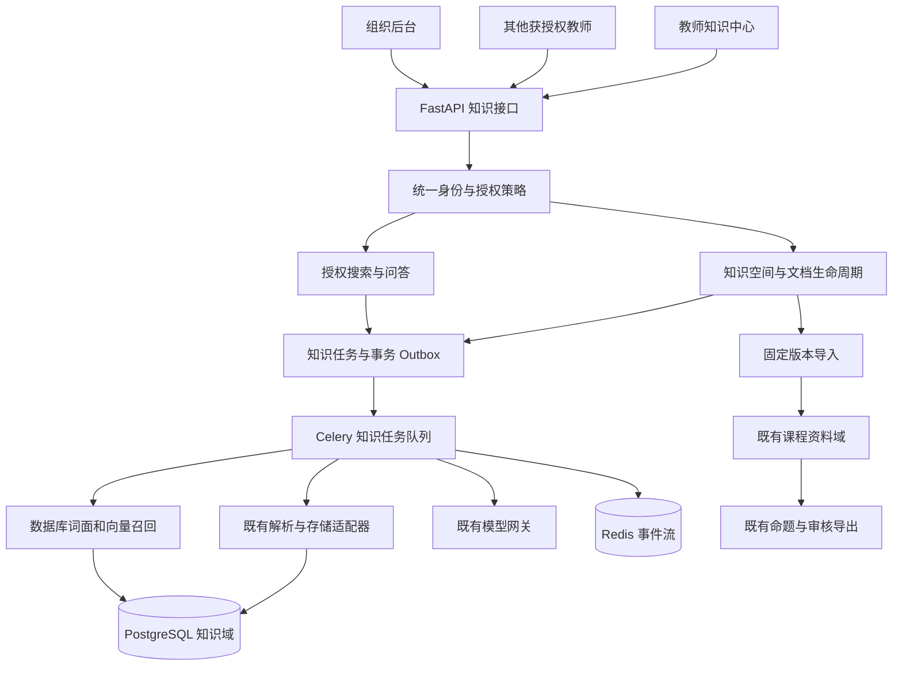

# PaperPact 校级教师共享知识库升级设计

> 版本：v1.1（教师端范围修订）。日期：2026-11-12。
> 状态：设计稿，尚未实施；本文中的新增功能、表、接口、指标均为设计目标。
> 输入前提：用户已有课程资料，本方案直接进入设计，不以再次收集资料或联系试用教师作为前置条件。
> 本期范围：仅现有教师与管理员身份，建设全校教师共享题库之前的资料与知识基础；不新增学生身份或学生端，不建设共享题目实体与题库业务。
> 设计依据：当前本地代码与上一轮隔离评估。没有读取真实上传资料、连接线上数据库或验证线上容量。
> 实施拆解：[2026-11-12-campus-knowledge-base.md](superpowers/plans/2026-11-12-campus-knowledge-base.md)。

## 1. 产品定位与本次决定

### 1.1 一句话定位

PaperPact 从个人课程命题工作台扩展为校内教师共享知识平台：教师上传、整理、审核和共享教学资料，其他获授权教师检索、问答并将资料快照用于自己的课程与命题流程。

产品名称继续使用 PaperPact，首页说明可用“教学知识库与 AI 命题工作台”。“校级”表示设计支持学校、学院、课程的组织范围，不代表已经获得学校采用或完成校级部署。

### 1.2 核心决定

| 决策 | v1 方案 | 原因 |
|---|---|---|
| 首要业务 | 课程与教学资料的共享、检索、问答 | 直接利用已有课程资料与现有代码 |
| 用户 | 现有 teacher、org_admin、admin | 不扩展用户身份枚举，知识库内另授维护/阅读角色 |
| 知识空间 | 独立于课程，归属一所学校，可归属其下学院 | 公共教学资料不需要虚构一门课程 |
| 共享方式 | 指定教师共享、学院教师共享、全校教师共享 | 默认仅指定成员；“全校”仅指本校有效教职工账号 |
| 跨库问答 | 同校、当前有权访问的知识库，首版一次最多 5 个 | 支持多课程资料综合，控制查询与上下文预算 |
| 命题衔接 | 教师确认后复制固定资料版本到课程 | 保持原有课程隔离与冻结语义 |
| 技术路线 | 现有单仓库、FastAPI、React、PostgreSQL、Redis、Celery | 不新增微服务或第二套主数据库 |
| 检索路线 | 数据库词面召回 + pgvector 语义召回 + RRF | 避免每次加载完整知识库正文 |
| 第一项实施 | 统一课程授权并补回归用例 | 上一轮已复现资料与会话访问的权限缺口 |
| 对外证明 | 可复现演示、固定评测集、明确版本与规模 | 功能数量不替代实际效果证据 |
| 共享题库关系 | 本期只建设前置的资料、授权、版本和溯源能力 | 原有命题继续使用，未来共享题库另行设计 |

### 1.3 不在 v1 范围内

- 新增学生身份、学生端、学生问答、学生成绩与学情预测。
- 全校共享题库、题目级发布与审核、跨教师题目复用计数、共享试卷市场；原教师私有命题能力保留。
- 在线考试、在线阅卷。
- 校务办事自动执行、科研成果管理、论文代写、全校网站爬取。
- 统一身份认证、跨学校共享、自助注册、公开互联网知识库。
- 多智能体自治、GraphRAG、知识图谱数据库、模型微调。
- 视频和音频入库、多模态问答；文档中的公式和表格沿用解析能力，但不承诺图片语义理解。
- 自动将已有私有课程资料、试卷、答案、历史对话发布给其他教师。

### 1.4 与既有规范的关系

本设计保持现有 teacher/org_admin/admin 账号身份与教师命题工作台，新增教师共享知识中心。不增加学生入口、在线考试与阅卷。现有课程表、课程级查询、缓存和存储仍必须带 `course_id`。

新知识域使用强制 `school_id` 及资源范围（`space_id` 或个人 `session_id`），属于新增显式隔离域，不把现有表的 `course_id` 放宽为可空。实施首阶段应同步更新工程规范对新域的说明，保留原课程隔离规则。

问答通过既有模型网关调用，不绕过命题合同生成试题。三个封存工作流 `framework_graph.py`、`organization_graph.py`、`generation_graph.py` 不在本次默认改动范围内。

## 2. 当前基础与已确认缺口

| 当前事实 | 源码依据 | 设计处理 |
|---|---|---|
| 已有学校与学院两级组织，账号角色为 admin/org_admin/teacher | `backend/app/db/schema.py`、`api/v1/admin/users.py` | 保留账号角色；知识库角色独立授予 |
| 课程由 owner 持有，课程详情检查 owner | `services/course_service.py::get_owned_course` | 原课程仍保持 owner 语义 |
| 资料、助手若干入口仅检查登录，不检查课程所有权 | `api/v1/materials.py::list_materials`、`api/v1/assistant.py::list_sessions` | 统一课程授权依赖，覆盖整组子路由 |
| 资料问答已有向量、BM25、RRF、多查询、邻域扩展 | `services/assistant_service.py::_rank_rag_chunks`、`services/langchain_retrieval.py` | 复用排序与处理逻辑，替换全量装载路径 |
| 内容索引按课程加载所有可检索正文 | `services/content_index_service.py::load_content_chunks` | 新域只回传有权限的候选片段 |
| 来源卡已含资料名、页码、章节与 block_id | `services/assistant_service.py::execute_rag` | 扩为固定版本引用与授权原文入口 |
| 知识目录必须先有已发布命题框架和确认考点 | `services/knowledge_publish_service.py::create_organization_state` | 新知识库不依赖命题知识目录 |
| 任务、outbox、模型调用及助手会话均为课程级结构 | `db/schema.py`、`infrastructure/tasks/models.py`、`domain/model_calls.py` | 新域独立存储，复用基础设施与适配器 |
| 既有说明没有离线评测集系统调参记录 | `docs/RAG_PIPELINE_INTERVIEW.md` 第 10 节 | 补标注集、基线、版本化实验记录 |

2026-11-12 的隔离复现：临时 SQLite 内存库、合成教师 A/B、注入已认证 A。访问 B 的课程详情返回 404，资料列表和助手会话列表返回 200 并读到 B 的记录。这验证了本地授权缺口；不是线上攻击测试，也不是已修复结论。

## 3. 用户与主要流程

### 3.1 教师发布课程资料

1. 创建知识库，选择所属学院、读者范围与学科标签；默认仅成员可读。
2. 上传资料，或从自己课程中选择一个确定版本导入。
3. 系统异步解析、切分和建索引，展示失败原因与可重试操作。
4. 教师预览正文、目录和定位，确认资料适合目标读者。
5. 有发布权限的教师提交发布；系统原子切换有效版本。
6. 其他教师在授权范围内搜索、阅读和提问。

### 3.2 其他教师检索、备课与复用

1. 教师从现有工作台进入知识中心，仅看到自己可访问的已发布资料。
2. 选知识库或课程标签，查找适合备课的概念解释、实验步骤、课程规范或教学案例。
3. 提问或对比多份资料后获得答案、编号引用、版本与页码/章节位置。
4. 点击引用打开该固定版本；发现错误可反馈“答非所问、引用不支持、资料过期”。
5. 无证据时得到范围明确的未找到提示；没有权限时不显示受限资料名称。

### 3.3 教师复用知识进入命题

1. 在授权资料上选择“导入我的课程”。
2. 选择自己拥有的目标课程，查看源版本、用途、复制范围及撤回规则。
3. 显式确认后，异步复制文件与可兼容的解析结果，形成课程独立版本。
4. 后续继续原有框架、知识目录、蓝图、合同、生成与审核流程。
5. 源文档升级只显示更新提示，不覆盖课程快照或已冻结试卷。

### 3.4 单位管理员治理

查看本单位空间数量、建库失败、调用量、耗时与反馈汇总；管理归属和账号。管理员身份不自动赋予教师私有文档、个人问答或命题答案的阅读权限。

## 4. 功能分期与交付边界

| 能力 | 首个可演示版本 D1 | 完整 v1 |
|---|---|---|
| 既有课程授权修复 | 必须 | 持续回归 |
| 独立知识空间 | 单库、成员授权 | 学院/学校范围、最多 5 库联合问答 |
| 文档管理 | 上传、解析预览、发布、撤回 | 版本替换、有效期、重建、批量导入 |
| 检索问答 | 单库搜索、固定来源引用、无证据响应 | 私有多会话、跨文档回答、反馈与运行明细 |
| 教师协作 | 指定教师 reader/editor/publisher 授权 | 学院/全校教师范围及撤权回归 |
| 命题衔接 | 原系统继续可用 | 固定版本双向导入与更新提示 |
| 评测 | 固定小集和权限测试 | 100 条标注集、保留集、消融与压力报告 |
| 运维 | 任务失败可见、审计 | 配额、备份恢复验证、灰度及回滚 |

既有资料是输入资产，D1 即可使用。资料总量、格式比例、学校名称和实际并发未知，均在导入预览或基准测量时记录，不虚构。

### 4.1 与未来全校共享题库的衔接

本期交付“教师资料共享 -> 带来源的知识检索 -> 导入自己的课程 -> 原命题流程”。可共享的公开练习与教学例题以文档形式存在，不拆成面向全校的题目实体，也不开放他人未发布试卷。

未来共享题库可以在这套学校/学院授权、版本、审核与来源记录上扩展题目所有者、共享许可、知识点标签、审核状态与题目版本。具体表结构、题目答案访问、试题引用/复制与考核保密另行设计，本期不预建空题库或改动原已冻结试卷。

## 5. 总体架构与模块职责



保持单体部署。知识 API 与原 API 共用进程；知识长任务可使用同一 Celery 集群的独立队列 `knowledge`，避免大批量建索引占满命题与问答并发。

| Module | Interface：调用者需要知道的内容 | Implementation 与复用 |
|---|---|---|
| 授权 | `authorize(actor, action, resource)`；拒绝即无数据返回 | 校验学校、当前账号状态、成员、发布状态与有效期；路由和 worker 共用 |
| 文档生命周期 | 创建版本、提交处理、审核发布、撤回 | 文件版本、解析任务、索引构建、原子生效，复用存储和解析适配器 |
| 检索 | `search(actor, scope, query, limit)` 返回授权证据 | 数据库召回、排序融合、邻域扩展；不向调用者暴露全库正文 |
| 问答 | 入队、取消、恢复本人会话 | 检索、引用白名单、答案验证、授权输出、运行指标 |
| 课程导入 | 导入源版本到自己课程，返回导入任务 | 复制快照与来源映射；不改命题领域引擎 |

模块 Interface 应包含权限、版本、幂等和错误语义。数据库实现与内存测试实现确有差异时再引入 Adapter；不为未来向量数据库预先堆叠通用框架。

## 6. 组织、角色与授权

### 6.1 租户归属

- 一条知识数据固定属于一个 `school_id`，创建后不可普通编辑改校。
- 学校成员由当前 `users.organization_id` 解析：学校本身或其下学院。无法解析的账号不能建校级空间，也不能获校内共享权限。
- `org_id` 表示空间责任单位，可为学校或所属学院；校验它属于 `school_id`。
- 所有知识域查询带 `school_id`，空间资源进一步带 `space_id`。子资源使用复合外键防跨空间引用。
- 账号换院、换校、停用时立即重算授权；旧学校成员授权不会跟随账号跨校生效。
- 原课程 owner 模型保留。v1 不新增多人协作编辑同一份试卷。

### 6.2 平台身份与知识库角色分开

`users.role` 保持 `teacher/org_admin/admin` 三种现有值。知识库成员角色为 `owner/editor/publisher/reader`；reader 也是教师，只在该知识库中没有编辑权，不等同于新增用户身份：

| 操作 | owner | editor | publisher | reader / 共享范围读者 |
|---|---|---|---|---|
| 读取有效发布资料、搜索、问答 | 是 | 是 | 是 | 是 |
| 查看草稿、预览处理结果 | 是 | 是 | 是 | 否 |
| 上传、创建新版、修改草稿 | 是 | 是 | 是 | 否 |
| 发布、撤回、设有效期 | 是 | 否 | 是 | 否 |
| 修改共享范围、导入许可 | 是 | 否 | 否 | 否 |
| 邀请成员、授权、移交 owner | 是 | 否 | 否 | 否 |
| 查看他人私人问答 | 否 | 否 | 否 | 否 |

平台/单位管理员可在管理范围内创建空间并指派合格教师 owner，或处理 owner 停用后的移交，全部留审计；管理身份本身不绕过内容授权。空间始终恰有一个 owner 记录，移交在单事务完成。owner 停用时停止新增发布与共享策略变更，由范围内管理员移交后恢复；不为保证 owner 有效而阻止账号停用。

### 6.3 教师共享范围与资料分类

空间 `read_scope`：`members`（指定教师）、`organization`（单位内教师）、`school`（本校教师）。候选用户仅为当前有效且学校归属匹配的 teacher/org_admin/admin；没有组织归属的全局 admin 可管理配置，但不能自动读取内容。organization 范围为责任学院本身；责任单位为学校时覆盖本校及其学院。显式成员也不能突破学校隔离。本期不增加 audience 字段或师生分流逻辑。

从成员表移除用户只撤销显式成员授权；用户若仍满足 organization/school 共享条件，仍有读权限。v1 不做“全校共享但排除某个人”的例外拒绝列表，设置页必须显示这一语义，不能将移除成员提示成完全撤销访问。

本期知识库统一用于教学资料共享，不再增加考试资料专用知识空间。未公开试卷、答案细则及考试保密材料继续保留在原课程私有域，禁止导入共享知识域。公开练习、教学例题及随附讲解可以作为教学文档导入，发布者必须确认其可共享性；这不等于建设题库。

v1 不做任意逐文档 ACL；同一空间采用一致策略。需要更小范围的资料放入独立空间。文档 `classification` 为 `shareable_teaching`（可共享教学资料）或 `limited_teaching`（限指定教师资料）；后者只允许 members 空间。考试保密材料属于拒绝入库类型，继续由原课程域管理。人工发布确认和分类校验共同使用；关键词扫描只提示风险，不能代替人工判断。

扩大 read_scope 属于重新发布：先生成影响预览，展示将新增可见的当前文档版本；owner 显式确认后才能生效。limited_teaching 文档阻止扩大范围，不自动改分类。已 superseded 的历史版本保留发布时的 classification、read_scope 与责任单位上限，不因当前版本扩大范围而自动向全校教师开放；若需扩散旧内容，作为新版本重新审核发布。历史 members 范围仍按当前显式成员判定，移除成员后旧版不可读。

### 6.4 授权判定与所有读取路径

```text
账号有效 + 所属组织有效
  -> school_id 匹配
  -> 空间有效且范围/成员角色允许
  -> 文档未撤回、版本已发布、有效期覆盖当前时间
  -> action 对应权限（read / edit / publish / import）
  -> 返回最小可见字段
```

没有权限与资源不存在统一返回 404；已能看见资源但无修改权时返回 403。草稿预览走单独管理权限，不能通过普通问答检索草稿。

必须覆盖列表、搜索、问答、原文、附件、来源链接、会话历史、SSE、反馈、后台详情、任务进度。邻域扩展和重排使用同一授权候选集合，不能先取全库 top-k 再交给模型过滤。

旧课程路由统一挂载 `require_owned_course`，覆盖 materials/framework/knowledge/exam_projects/paper_versions/paper_archives/assistant 及其任务流。由此加载出的服务端 actor 和 course 上下文写入任务，worker 开始和输出前重新校验；禁止相信前端传来的 owner_id。

### 6.5 撤权、历史与缓存

- 用户增加 `authz_version`，账号状态、组织、角色变化时递增；空间使用 `policy_version`，成员或共享策略变化时递增；文档使用 `access_version`，撤回或发布状态变化时递增。
- v1 不缓存正向授权判定，不缓存最终问答答案。请求、worker 和输出通道读取数据库当前授权；数据库不可用时停止内容输出。
- 检索缓存若后续启用，键必须包含学校、用户、选定空间、授权版本、文档有效版本集合及检索配置；TTL 不能替代撤权机制。
- 会话和消息归个人，分享一个知识库不分享会话。历史答案带依赖版本列表；任一依赖撤权时整条答案隐藏，不只移除引用。答案依赖是本轮证据与实际使用的历史回答依赖的并集，避免多轮总结丢失来源后逃过撤权；已由用户手工复制并重新输入的内容无法可靠追溯，不能承诺自动收回。
- 源文档被新版本替换后，历史答案标注“基于旧版”；读者仍有当前文档权限、旧版未撤回且满足旧版发布时的 classification/read_scope 上限时可核对旧引用。旧版不进入默认新问答。已到期且没有有效后继版本的文档，普通读者不能借历史会话继续获取内容。
- 未返回的回答在输出前重新校验；SSE v1 只流式传状态，最终答案验证后一次返回。撤权已经提交后发起的请求不得返回内容；已经发送给浏览器或被下载的内容无法收回，这一限制在共享与导入界面明确显示。

## 7. 数据模型

### 7.1 设计约束

保留原课程表不变，新表统一 `knowledge_*`。凡列出 `space_id` 的表必须带 `school_id`；外键连接 `(id, school_id, space_id)` 等同域键，父表建立对应唯一约束。会话/问答任务可跨同校多个空间，以 `school_id + session_id + owner_id` 隔离，不能随意挂到其中一个空间。

数据库是权限、发布状态和版本指针的权威。Redis 只存队列、短期进度和经授权获取的事件，不作为最终权限来源。

### 7.2 逻辑表清单

| 表 | 核心字段 | 约束与用途 |
|---|---|---|
| `knowledge_spaces` | id, school_id, org_id, name, read_scope, retrieval_mode, allow_course_import, subject_tags, status, policy_version, created_by | 创建默认 members，retrieval_mode 默认 hybrid；名称同责任单位内唯一；标签不授予权限 |
| `knowledge_memberships` | id, school_id, space_id, user_id, role, created_by | UNIQUE(space_id,user_id)；仅同校有效教师账号可加入，管理员身份不自动授权 |
| `knowledge_upload_sessions` | id, school_id, space_id, uploader_id, object_key, expected_hash, size_bytes, mime_type, expires_at, status | 临时上传到期、校验后才能完成版本创建 |
| `knowledge_documents` | id, school_id, space_id, title, classification, status, published_version_id, access_version, created_by | 活跃版本必须属于该文档；文档 id 长期稳定 |
| `knowledge_document_versions` | id, school_id, space_id, document_id, version_no, file_hash, object_key, size_bytes, mime_type, state, effective_from, effective_to, approved_by, published_at, publication_policy_snapshot, serving_build_id, import_origin | UNIQUE(document_id,version_no)；发布后内容、分类快照、有效期不可原地更改 |
| `knowledge_parse_runs` | id, school_id, space_id, version_id, parser_profile_hash, state, artifact_prefix, error_code, attempts | 记录解析产物；同内容/解析档案可在授权范围内复用 |
| `knowledge_blocks` | id, school_id, space_id, parse_run_id, block_index, block_type, text, markdown, latex, page_index, bbox, heading_path | 解析证据不可变，引用定位的稳定来源 |
| `knowledge_retrieval_profiles` | id, school_id, version_no, embedding_config_ref, embedding_model_id, embedding_dim, tokenizer_version, chunking_config, state | 配置快照不可变；每校至多一个 active；配置引用不保存明文密钥 |
| `knowledge_index_builds` | id, school_id, space_id, version_id, parse_run_id, retrieval_profile_id, pipeline_hash, embedding_model_id, embedding_dim, state, expected_chunks, ready_chunks | 一次独立派生索引；成功后才能成为 serving_build |
| `knowledge_chunks` | id, school_id, space_id, build_id, chunk_index, text, source_blocks, content_hash, lexical_tsv, embedding_model_id, embedding_dim, embedding, embedding_vec | source_blocks 包含 block_id 与字符范围；UNIQUE(build_id,chunk_index)；模型维度必须与 build 一致 |
| `knowledge_sessions` | id, school_id, owner_id, kind, title, selected_space_ids, status, created_at, updated_at | kind=conversation/search；选择空间最多 5 个；每轮重新校验 |
| `knowledge_messages` | id, school_id, session_id, role, content, state, sources, dependency_versions, retrieval_snapshot, feedback | 不存模型内部思考；引用与答案必须可追溯 |
| `knowledge_jobs` | id, school_id, space_id?, session_id?, actor_id, kind, payload, payload_hash, state, progress, attempts, fencing_token, lease_owner, lease_until, idempotency_key, result, error_code | space_id 与 session_id 恰有一个非空；每次尝试有 fencing token |
| `knowledge_outbox_events` | id, school_id, job_id, event_type, state, attempts, available_at, claim_owner, claim_until | 任务与事件同事务；至少一次派发、幂等消费 |
| `knowledge_model_calls` | id, school_id, job_id, actor_id, stage, provider, model, status, tokens, duration_ms, prompt_hash, error_code | 只存脱敏观测，不复制课程 model_calls |
| `knowledge_audit_events` | id, school_id, space_id?, actor_id, action, resource_type, resource_id, before_metadata, after_metadata, request_id, created_at | 记录授权/发布/撤回/导入，禁止保存完整资料正文 |
| `course_knowledge_imports` | id, course_id, school_id, space_id, source_document_id, source_version_id, target_material_version_id, source_hash, permission_receipt, state | 唯一源版本+目标课程；固定版本来源与复制许可记录 |

首版评测采用版本化 JSONL 与实验报告，不先增加评测数据库。反馈先保存在消息字段中，一人一条消息可修改自己的反馈；另行提交自愿共享给维护者的问题和答案摘录。

`embedding_vec` 是 PostgreSQL 部署上的原生向量列，测试用 JSON/内存替身。为支持新旧维度并存，知识表采用不固定维度的 vector 列，记录 embedding_dim 并约束实际维度与 build 一致；对已允许的模型和维度创建带固定维度转换的部分表达式 HNSW 索引，查询必须匹配其表达式与模型条件。迁移不清空旧向量列。建库前检查扩展版本、索引维度上限和执行计划；不存在扩展时允许本地测试与明确标识的词面模式，不能宣称已具备正式混合检索部署能力。

### 7.3 版本与跨域引用

文档版本保存源文件快照；解析 run 和索引 build 是派生版本。引用同时携带 document_version_id、parse_run_id、block_ids 和 chunk_id，索引重建不改变原文证据。向量模型变化创建新 build，完成后 CAS 切换 serving_build_id，旧 build 保留至引用保留期结束。

`import_origin` 记录 course_id、material_version_id、内容哈希与导入操作者快照。课程删除后知识域副本仍存在，来源可标记 unavailable；不建立会随课程删除级联消失的硬依赖。知识域导入课程的来源映射亦不得使旧版课程删除逻辑误删共享知识数据。

### 7.4 必须建立的索引

- 空间列表：`(school_id, org_id, status)`；成员：`(space_id,user_id)` 与 `(user_id,school_id)`。
- owner：对 role=owner 建立每空间唯一约束；移交/删除成员锁定空间并校验至少一个 owner，不能仅靠前端隐藏删除按钮。
- 文档：`(school_id,space_id,status)`；版本：`(document_id,version_no)`、有效版本与 effective_to。
- 内容：`(school_id,space_id,build_id)`；块：`(parse_run_id,block_index)`；词面列 GIN；向量列按实际计划使用 HNSW 或精确扫描。
- 会话：`(school_id,owner_id,updated_at)`；消息：`(session_id,created_at,id)`。
- 任务：`(school_id,state,lease_until)`；幂等：`(school_id,actor_id,kind,idempotency_key)`。
- Outbox：同一任务同一事件类型仅一个 pending/claimed 事件；审计按学校、资源和时间查询。

## 8. 文档生命周期与发布事务

### 8.1 入库与状态

```text
上传会话 created -> uploaded -> verified -> completed
                         -> expired / failed

文档版本 draft -> processing -> ready -> published -> superseded
                    -> failed     |         -> withdrawn
                                  -> rejected
```

解析和索引是 processing 内的独立任务状态，前端展示“上传校验、解析、切分、索引”具体阶段。失败不改变现有有效版本，重试从失败阶段继续。相同幂等键返回原任务；主动重试生成新的 attempt，不能重复产生版本或发布事件。

v1 不支持定时发布：发布时 `effective_from <= now`，`effective_to` 可空或在未来。到期过滤在每次查询执行，不能依赖定时任务及时运行。修改已发布内容或有效期需要新版本；撤回可以立即执行。

### 8.2 发布前检查

1. 操作者有发布权限且账号有效；空间状态和分类允许目标教师共享范围。
2. 文件校验通过，解析成功，正文非空，索引 build 完整。
3. 发布者完成原文预览与分享确认；limited_teaching 不得扩大到全校，考试保密资料不得导入共享域。
4. 有效期合法，版本号和预期旧版本未发生并发变化。
5. 原文与索引元信息完整，来源链接可在当前身份下打开。

发布在同一数据库事务中锁定文档，校验 expected_published_version_id，设置新版本 published、旧版 superseded、当前版本指针和 serving_build_id，并递增 access_version、写审计与 outbox。文件与该检索模式要求的索引必须已完成，不能先公开再等待索引。

默认混合检索模式下，完整 build 要求词面与向量两路均通过完整性检查；只有经部署配置明确选择 lexical 模式的空间可在无向量情况下发布，模式必须显示且进入评测记录。published 或 superseded 版本都可被撤回，撤回旧版同样使依赖它的历史答案受限。

索引重建失败时旧 build 继续服务；撤回时先在数据库失效，后异步清理缓存和派生索引。清理失败不得使文档重新可见。空间归档等价于其全部文档停止对普通读者服务。

### 8.3 重复、冲突与一致性

- 内容相同只在同一学校、已授权的数据范围内复用解析/嵌入；不能通过哈希查询暴露其他学校文件是否存在。
- 版本号由数据库并发控制分配，不使用前端计算的 max+1。
- 同名文档默认提示创建新版本或重命名，不静默覆盖。
- 同一问题召回相互矛盾但仍有效的不同文档时，标明各自适用范围和来源，无法消解则提示冲突，不自动以“上传时间最新”判定权威。
- v1 不自动删除已被历史引用的文件和解析块。物理清理必须验证版本引用与保留策略，不能按对象前缀直接递归删除。

## 9. 解析、切分与索引设计

### 9.1 复用边界

复用 `adapters/document` 的解析客户端、协议与本地文本解析，复用存储 Adapter、嵌入网关、响应校验、批量限制与错误分类。新增知识域编排与持久化，避免复用要求真实 `course_id` 的 `parse_service` 或 `content_index_service` 时伪造课程。

v1 接收当前适配器已支持并经样例验收的文档格式；PDF、DOCX、Markdown、TXT 列为首批验证目标。文件选择器按后端能力返回支持格式，不因文件后缀存在就声称解析成功。PPTX 等格式通过单独样例验收后再开放。

课程导入如果原文件哈希、解析器档案和块协议版本一致，可复制解析产物并重新分配知识域 id；否则重新解析。所有复制产物必须保留完整的源文件与新对象路径，不能依赖课程后续仍存在。

### 9.2 切分规则

- 优先保留标题层级、段落、页码和阅读顺序；切片携带完整章节路径。
- 初始目标每块约 800–1200 中文字符、重叠约 100–150 字；这只是待评测参数，不作为通用最优值。
- 表格按表头与行分组，保留原始块；公式保留 LaTeX 与周围解释，不把 HTML 标签直接当正文语义。
- 小标题附着相邻正文，避免独立短块挤占召回；长代码按逻辑段切分并保留语言和章节。
- `source_blocks` 保存块 id、字符区间与原页位置，不把合并块的首个页码当作全部页码。
- 扫描件缺字、表格错位、空文本标记质量警告，教师在发布前确认。无真实页码的 TXT/Markdown 只展示章节或段落，绝不生成虚假页码。

切分配置形成 `pipeline_hash`，输入包括解析协议版本、清洗版本、切分规则、tokenizer 版本、嵌入模型与维度。不同 pipeline 的索引不得混用。

### 9.3 嵌入与模型升级

每个 build 固定 embedding_model_id 和维度。v1 同一学校所有可联合查询的空间使用同一生效嵌入模型；新模型先对有效文档构建影子 build，全部就绪后在一个事务内切换各文档 serving_build 指针，避免问答混入两个向量空间。切换事务与文档发布操作通过学校级锁协调，防止迁移期间漏掉新发布版本。读请求在单次数据库快照中选定各文档 build。未来需要按模型分别嵌入并融合排名时另作扩展，v1 不静默混用新旧模型。

生效模型由 `knowledge_retrieval_profiles` 的 active 配置决定，候选配置与当前配置可同时存在。配置引用指向部署方批准的供应商地址、型号和密钥环境变量名，由既有嵌入网关解析使用；不能只记录 model 名后始终读取已经改变的全局 settings。切换 active profile 与各版本 serving_build 在同一事务完成，新建文档固定当前 profile；旧凭据在旧任务排空前保留。只有平台管理员能创建或切换此配置，教师不能借配置引用任意外部端点。

后台批量生成向量并增量落库，失败记录可重试范围；问答请求不执行全库补嵌。索引缺失时显示“索引构建中”，可选择明确标识的词面检索降级，不将长时间修复工作隐含在一次问答里。

## 10. 授权检索与问答

### 10.1 标准执行链

```text
问题 + 用户选定的空间/文档
  -> 服务端校验身份、学校及当前访问范围
  -> 读取有效 published 版本与 serving_build
  -> 问题规范化，最多 2 个确定性查询变体
  -> 数据库词面候选 + 向量候选（相同权限和版本条件）
  -> RRF 融合、去重、可选重排
  -> 同版本内邻域补充，控制上下文预算
  -> 构造引用白名单并调用回答模型
  -> 校验答案结构、引用存在与证据覆盖
  -> 再验当前授权与版本状态
  -> 持久化本人消息与来源，返回最终答案
```

搜索和问答共享检索 Module；搜索只展示有权限的候选，不调用答案模型。教师知识问答使用独立只读入口；需要命题时通过明确操作导入自己的课程，进入原课程助手，不把共享库阅读权限扩大为修改他人课程的权限。

### 10.2 数据库词面召回

v1 选择 PostgreSQL 全文检索作为生产词面通道：复用现有中英 tokenizer 输出预分词文本，用固定 `simple` 配置构造 `tsvector`，建立 GIN，候选按 `ts_rank` 排序。查询由后端将合法 token 构造参数化 tsquery，候选召回使用 OR 组合与覆盖率复核，避免 n-gram 全 AND 导致零结果；不接收用户原始 tsquery 表达式。

这条新通道应准确标为“PostgreSQL 词面召回”，不是 BM25。现有 BM25 保留为原课程链路与离线基线；是否引入数据库 BM25 扩展，由保留集收益和维护成本决定。先验证预分词后 `to_tsvector` 的实际 lexeme、单字查询、英文标识符和数字编号，避免假设中文天然被正确切分。

只在数据库返回有权限的 top-k 后装载正文。索引内部允许维护全域统计，但不得把无权文档的标题、片段、命中数或查询明细暴露给用户。

### 10.3 向量召回与过滤

过滤条件至少包含学校、授权空间、published 当前版本、有效期、当前 build、embedding 模型。查询中保留这些 SQL 条件，并在结果构造时复核归属。

HNSW 是候选加速，不是授权机制。近似扫描叠加过滤可能返回不足 k 条；部署前检查扩展版本、执行计划和过滤选择率。可用时启用有上限的迭代扫描；小范围或高选择性条件走精确搜索。记录“符合条件的资料足够但候选不足”的测试用例，不能通过移除权限过滤补足候选。首期可用共享索引加学校过滤；出现多校容量竞争后以实测决定按学校分区，不把应用数据隔离宣传为物理索引隔离。

### 10.4 初始预算与降级

| 项目 | 初始设计值 | 说明 |
|---|---|---|
| 联合知识库 | 最多 5 个 | 同一学校，逐个授权 |
| 查询变体 | 原问题 + 最多 1 个核心变体 | 优先确定性；不默认多轮模型改写 |
| 单通道候选 | 30 条 | 跨所选库统一排序，保留库来源 |
| 融合后候选 | 20 条 | 按版本和内容去重 |
| 最终证据 | 默认 6，最多 8 片段 | 同文档集中度要记录，避免重复片段占满 |
| 上下文 | 初始最多 8000 tokens | 按模型输入上限调整，不能仅按字符数假定 token |
| 回答 | 初始最多 1500 output tokens | 适合资料问答；大范围总结要求缩小范围 |
| 外部调用重试 | 瞬时错误最多额外 1 次 | 参数错误、权限错误、余额不足不盲重试 |

这些数字是实现起点，最终由开发集调参。回答模型配置只通过既有工厂和型号档案解析。新增 `knowledge_answer` purpose，缺绑定时回落 default；嵌入继续使用既有独立网关，输入固定的知识检索 profile，并在 build 中记录生效型号。重排默认关闭，开发集证明收益且保留集验收通过后再启用，耗时与费用计入评测。

故障处理：向量调用失败可以降级词面并显示模式；模型回答失败仍可返回已授权检索结果，但不得把片段拼接冒充完整答案。数据库权限状态读取失败时停止返回，不能使用旧授权兜底。

### 10.5 引用与回答契约

答案按声明组织，模型只能引用本轮分配的 source_id。下面是协议示例，不代表已有接口输出：

```json
{
  "answer_status": "answered",
  "claims": [
    {"text": "该实验要求先准备输入数据，再执行检索验证。", "source_ids": ["S1"]}
  ],
  "limitations": [],
  "sources": [
    {
      "source_id": "S1",
      "document_id": "doc_example",
      "version_id": "version_example_2",
      "parse_run_id": "parse_example",
      "chunk_id": "chunk_example",
      "block_ids": ["block_example"],
      "page_index": 3,
      "heading_path": ["实验要求"],
      "title": "实验指导",
      "quote": "先准备输入数据，再执行检索验证。"
    }
  ]
}
```

`answer_status` 为 `answered/partial/insufficient_evidence/conflicting_evidence`。引用元数据和 quote 由服务端从证据构造，模型不能任意生成 URL、页码或文件名。page_index 按解析协议存储，展示时统一转换为从 1 开始的页码。

确定性检查 source_id 属于白名单、引用原句可定位、正文非空和格式合法；它不能证明语义正确。原始证据与结论的支持关系通过离线人工评测验证，线上提供反馈。结构校验失败最多修复一次，仍失败则只展示已授权检索结果。

问答任务固定检索快照；答案输出前若当前 published 版本或 serving_build 已变化，丢弃待输出答案并最多重检索一次。持续变化时返回“资料正在更新，请重试”，不把检索时的旧内容标成当前答案。已完成的历史回答按历史规则保留标识与授权检查。

无命中时直接返回未找到，不调用答案模型；有片段但不能支持问题时允许模型输出 partial/insufficient_evidence。相似度是召回信号，不能以“相似度 90%”表示答案可信度。

### 10.6 提示注入与只读约束

上传资料、引用、用户输入均视为内容，不得改变系统授权或调用工具。教师知识问答没有发布、下载任意 URL、读取未授权空间或直接生成试卷的工具；相关写操作由有权教师通过明确界面执行。服务端决定检索范围与来源地址，不允许模型产出的 school_id/space_id 扩大范围。

v1 的对话记忆只使用本人近期消息；历史回答若依赖已撤权资料，从下一轮上下文剔除。多轮改写不能继承此前更大的知识范围。消息中不保存或展示模型内部思考过程。

## 11. 个人会话、异步任务与调用观测

### 11.1 与旧基础设施的兼容方式

旧 `task_runs/outbox_events/model_calls/assistant_sessions` 强绑定课程，继续服务现有业务。新知识域采用第 7 节的对应表，复用 Celery、Redis、模型工厂、解析/嵌入网关与已验证的任务状态规则。

实际出现两种数据域后，可从旧实现提取任务状态转换、重试分类和发布协议作为共享纯函数；保留课程 Adapter，并新增知识域 Adapter。不得复制整份 worker 或把所有 course_id 改成可空来“通用化”。新 Adapter 上线前要运行既有任务回归。

`KnowledgeCallContext` 包含 school_id、job_id、actor_id、stage；网关接受现有 ModelCallContext 或新上下文，record Protocol 不变。新增 recorder 写 knowledge_model_calls。新 recorder 不实现跨域 `lookup_response`，v1 不启用最终答案缓存；原课程缓存另行审计，不能自动沿用为学校级响应缓存。

### 11.2 任务可靠性

- 任务与 outbox 同事务提交，事件至少一次派发，handler 按幂等键与状态执行。
- worker 领取时写 lease 和递增 attempt/fencing token，持续心跳；只有当前 token 能写最终结果与事件。
- 任务 payload 保存 actor_id、资源 id、版本快照和策略版本，不保存客户端提供的授权结论。
- 排队期间撤权、账号停用或文档撤回，worker 检查后以 access_revoked 结束，不调用模型。
- 调用中撤权后丢弃待输出结果；无法保证收回已发送至已批准模型供应商的上下文，记录调用和撤销事件。
- 取消使用状态标记与租约围栏；外部调用无法立刻中断时允许完成计费，但禁止迟到结果覆写取消状态。
- 知识索引任务限并发，问答单独优先级；后台任务暂停不阻塞原命题队列。

### 11.3 会话和 SSE

`knowledge_sessions` 增加 `kind=conversation/search`。聊天会话出现在“我的问答”；异步搜索可创建短期 search 会话，绑定本人和最多 5 个空间，不出现在聊天列表，结果按可配置保留期清理。

SSE 使用现有带 Authorization 的 fetch 流客户端方式，禁止把 bearer token 放进 URL。事件为 queued/retrieving/generating/validating/completed/failed/cancelled，序号用于重连；只传执行状态，不透传模型 token。最终答案和来源在校验通过后一次发送。

事件流和最终结果接口校验会话 owner 与当前资料授权。Redis 流不可被客户端直接访问；重连不能直接重放已失效正文。连接过期或账号停用时断开并要求重新认证。

### 11.4 观测与预算

记录 queue_ms、retrieval_ms、embedding_ms、generation_ms、validation_ms、total_ms、候选数、来源版本、模式、tokens、失败阶段及配置哈希。运营后台仅返回授权范围内聚合；个人问题与正文不随普通调用明细返回。

调用费用按配置的供应商/型号价格估算并记录价格快照，缺价格或 usage 返回 unknown，不显示 0 元。重试、嵌入、解析和重排成本分别计入；成功逻辑调用与实际外部尝试次数分开统计。

初始可配置上限：单文件 100 MiB、单批 20 文件；每账号同时 1 个问答任务、最多 2 个排队问答；教师账号配置每分钟/每日请求上限。部署按供应商吞吐和实际样本调整，限流返回 429 与重试时间；解析服务更低限制时取两者较小值。此处是设计参数，非已验证容量。

## 12. 课程资料导入与命题衔接

### 12.1 课程到知识库

必须同时满足“源课程 owner”与“目标知识库 editor 以上”。导入固定 material_version_id，先预览文件名、类型、目标教师共享范围；从课程试卷归档、答案细则或其他考试保密资料导入知识库默认拒绝。复制后的新文档版本处于 draft/processing，不能自动发布。

当前课程资料后续修改、删除，不改变已复制知识版本。导入凭据记录操作者、源版本哈希和目标空间；不能仅保存指向源课程对象的地址。

### 12.2 知识库到课程

需要对源空间有 read 与 `allow_course_import` 许可、源版本当前有效，以及对目标课程有 owner 权限。知识库 reader 教师可在得到导入许可后导入自己的课程，但不能写入其他教师的课程。相同源版本与课程重复请求返回同一映射；不同源版本建立新课程资料版本。

源空间 owner 设置 allow_course_import 时，界面明确说明它允许生成独立课程快照：普通撤回会阻止后续读取和导入，但不会自动擦除已交付副本、已冻结合同或试卷。这是数据复制的产品语义，不承诺远程收回。

源文档发现严重内容问题时，通知导入课程 owner，并可阻止“从源再次导入”；课程 owner 决定替换未冻结资料和重新生成版本。更强的强制派生撤销不属于 v1，不能通过修改旧试卷破坏冻结语义。

### 12.3 复制的最小内容

复制源文件与版本哈希，按兼容性复制解析块或重新解析；全部目标对象写到目标课程路径并带 course_id。来源映射只是溯源，不允许原命题查询直接联表读取任意知识库。原生成器仍只消费课程内已经确认的知识卡与合同。

## 13. 接口草案

所有接口在 `/api/v1` 下，沿用现有认证与错误结构。以下为新增契约，尚未实现。创建/发布/导入等有副作用请求支持 `Idempotency-Key`，同键不同 payload 返回 409；幂等作用域包含 actor 与学校。

| 方法与路径 | 输入/输出重点 | 授权 |
|---|---|---|
| GET `/knowledge/spaces` | 游标分页、组织/学科标签筛选；不返回无权空间统计 | 当前可见空间 |
| POST `/knowledge/spaces` | org_id,name,read_scope,subject_tags | 合格教职工在自己组织建库；管理员可指派 owner |
| GET/PATCH `/knowledge/spaces/{sid}` | 详情；修改使用 expected_policy_version | 读者 / owner |
| POST `/knowledge/spaces/{sid}/policy-preview` | 扩大范围的文档、版本与读者影响 | owner |
| PUT/DELETE `/knowledge/spaces/{sid}/members/{uid}` | role；移交另走事务端点 | owner；不能删除最后 owner |
| POST `/knowledge/spaces/{sid}/transfer-owner` | target_user_id,expected_policy_version | owner 或范围内管理恢复 |
| POST `/knowledge/spaces/{sid}/upload-sessions` | 文件元数据，返回短期上传凭据 | editor+ |
| POST `/knowledge/spaces/{sid}/upload-sessions/{id}/complete` | 校验后返回文档版本与处理任务 | 原 uploader 且仍有 editor+ |
| GET `/knowledge/spaces/{sid}/documents` | 标题、分类、状态、版本、有效期 | 普通读者仅有效发布版本 |
| GET `/knowledge/spaces/{sid}/documents/{did}` | 元信息与当前版本 | 文档读权限 |
| POST `/knowledge/spaces/{sid}/documents/{did}/versions` | 追加上传会话/版本，不覆盖原文件 | editor+ |
| POST `/knowledge/spaces/{sid}/documents/{did}/publish` | version_id,expected_published_version_id,effective_to | publisher/owner |
| POST `/knowledge/spaces/{sid}/documents/{did}/withdraw` | reason,expected_access_version | publisher/owner |
| GET `/knowledge/spaces/{sid}/documents/{did}/versions` | 版本号、状态与变化，不向普通读者枚举受限版本 | 维护者；普通读者仅当前和已授权历史引用 |
| POST `/knowledge/spaces/{sid}/versions/{vid}/reject` | 审核理由，版本标记 rejected；修订另建新版本 | publisher/owner |
| POST `/knowledge/spaces/{sid}/versions/{vid}/process` | 首次处理或失败重试；返回幂等任务 | editor+ |
| POST `/knowledge/spaces/{sid}/versions/{vid}/reindex` | 指定已批准 pipeline，构建新索引 | publisher/owner |
| GET `/knowledge/spaces/{sid}/versions/{vid}/content` | 分页或 block_id 定位；历史权限复核 | 发布原文读或草稿预览权限 |
| GET `/knowledge/spaces/{sid}/versions/{vid}/file` | 经后端授权代理读取/范围请求 | 同原文权限 |
| POST `/knowledge/search` | space_ids,query,filters；返回 202 + 私有检索任务 | 逐空间授权 |
| POST/GET `/knowledge/sessions` | 创建/列出本人对话，最多 5 个 selected_space_ids | 本人 |
| GET/PATCH/DELETE `/knowledge/sessions/{id}` | 本人会话；删除不影响共享资料 | 本人 |
| POST `/knowledge/sessions/{id}/turns` | message,filters；返回 202、message_id、job_id | 本人 + 当前知识范围 |
| GET `/knowledge/sessions/{id}/messages` | 再授权后的历史，受限回答只返回占位状态 | 本人 |
| PUT `/knowledge/messages/{id}/feedback` | reason,comment,share_excerpt=false | 消息所属用户 |
| GET `/knowledge/jobs/{id}`、GET `/{id}/events` | 任务状态/结果、SSE | job actor 或获准管理该处理任务者 |
| POST `/knowledge/jobs/{id}/cancel` | 幂等取消 | 原发起者或对应维护者 |
| POST `/courses/{cid}/knowledge-imports` | 源 space/version；返回任务 | 源导入许可 + 目标 owner |
| POST `/knowledge/spaces/{sid}/course-imports` | 源 course/material_version；返回任务 | 源 owner + 目标 editor+ |
| GET `/admin/knowledge/overview` | 本单位规模、错误、耗时、费用未知状态 | 范围内管理员 |
| POST `/admin/knowledge/retrieval-profiles` | 新增已批准的不可变 profile，记录 school 与配置引用 | 平台管理员 |
| POST `/admin/knowledge/retrieval-profiles/{id}/activate` | 验证所有有效版本目标 build 完整，原子切换 | 平台管理员；失败保留原配置 |

所有新增 JSON 请求拒绝多余安全相关字段；school_id、actor_id、owner_id、published 标记由后端派生，不能 mass assignment。过滤文档 id 若与选定空间不一致，整次请求拒绝，不静默扩大检索。

“维护者查看任务”只适用于该空间的解析/索引处理任务；绑定 session_id 的搜索和问答任务始终仅原 actor 可读，空间 owner 或单位管理员不能借任务结果查看他人私人问答。

关键错误码：`RESOURCE_NOT_FOUND`、`ACTION_FORBIDDEN`、`VERSION_CONFLICT`、`INDEX_NOT_READY`、`ACCESS_REVOKED`、`FILE_VALIDATION_FAILED`、`QUOTA_EXCEEDED`、`MODEL_UNAVAILABLE`。`INSUFFICIENT_EVIDENCE` 是正常业务结果，返回成功任务与对应 answer_status，不计作系统故障。

## 14. 页面与交互设计

### 14.1 信息架构

```text
/knowledge                         知识中心：授权空间、搜索入口、最近访问
/knowledge/spaces/:spaceId          资料列表与空间内搜索
/knowledge/spaces/:spaceId/manage   资料处理、草稿、发布、版本
/knowledge/spaces/:spaceId/settings 成员、共享范围、用途、导入许可
/knowledge/ask                      我的问答，可选最多 5 个知识库
/knowledge/documents/:versionId     固定版本阅读与引用定位
/courses/**                        原教师课程与命题工作台
/admin/knowledge                   范围内治理与运行统计
```

保留现有教师登录与默认课程入口，增加“共享知识中心 / 我的课程”切换。教师在别人空间是 reader 时，只限制该空间编辑操作，仍可使用自己的课程与命题功能。模型设置继续按现有管理员权限控制；不增加学生路由或身份分流。原课程导航与工作台视觉继续使用，不借此次升级全局重设计。

### 14.2 关键页面

| 页面 | 主要内容 | 关键状态 |
|---|---|---|
| 知识中心 | 组织/课程标签筛选、空间列表、搜索框 | 无授权空间、空库、组织未设置 |
| 资料列表 | 标题、版本、分类、更新时间、发布/索引状态 | 草稿仅维护者可见，撤回不混入普通列表 |
| 管理页 | 上传队列、解析预览、版本对比、发布与撤回 | 单文件失败可重试，旧版本继续有效 |
| 问答页 | 左侧本人会话，中间问答，右侧引用阅读 | 处理中、无证据、部分回答、冲突、权限变化 |
| 原文阅读 | 文件/解析正文、页码章节、引用高亮 | 无真实页码则只用章节；旧版醒目标识 |
| 成员设置 | owner/editor/publisher/reader 与范围预览 | 跨校用户拒绝、扩大读者范围二次确认 |
| 治理页 | 任务错误、费用、反馈、索引构建与版本 | 不展示他人私人会话全文 |

搜索结果显示资料名、章节、版本、摘要和“查看原文”，不展示伪可信百分比。问答引用编号与原文位置一致；侧栏关闭后可重新打开，不改变当前滚动位置。

沿用当前组件、字体和配色，新增组件集中在 `components/knowledge`。全局状态按空间、任务、个人会话分别放 Zustand store，调用统一经 `src/api/`。前端守卫负责体验，后端负责授权。

## 15. 安全、保留与运行保障

### 15.1 上传与文件访问

上传路径包含学校、空间、上传会话与随机对象 id，文件名只作为显示元数据。校验字节数、哈希、类型与实际解析结果；后端不能把用户给出的路径当作对象键。解析只读取系统签发的对象，v1 不支持任意 URL 抓取。

私有文件读取走授权代理，避免长期预签名 GET 在撤权后继续有效；上传凭据短期有效且限定对象。原有 local-storage 回退入口在 P0 一并审计，正式共享部署禁用无授权的公共 PUT。解析与上传异常不能泄漏本机路径、供应商密钥和完整内部响应。

解析出的 HTML、Markdown、表格、文档标题和模型回答均经可信渲染与净化，禁用脚本、事件属性、危险协议和未经允许的远程嵌入。引用高亮按文本偏移生成，不直接拼接用户 HTML。大文件代理分块发送时定期重验授权；撤权无法收回已经发送的字节。

### 15.2 个人数据与运维可见性

对话默认个人所有。维护者看到反馈分类；用户主动勾选分享问题和答案摘录后才可查看摘录。管理员只获得聚合和脱敏错误；必要的受控排障访问必须单独授权并留下审计，不建立默认“看所有对话”入口。

初始保留建议：个人问答 90 天、search 临时结果 24 小时、脱敏任务日志 30 天、授权与发布审计 180 天，均为产品默认配置而非法律要求。用户可主动删除会话，备份中的副本按备份保留期过期；文档版本因引用需要采用单独保留策略。

资料发送至解析或模型供应商前按部署配置明确处理去向；敏感教师资料只能使用部署方允许的供应商。前端不提供自填任意供应商 URL 的入口。

### 15.3 一致性与故障

- 数据库失败：停止授权读取，不从旧缓存继续回答。
- Redis/Celery 失败：outbox 保持 pending，展示排队/服务不可用，不丢任务。
- 索引失败：草稿不发布、旧版继续服务，支持限次重试。
- 模型失败：保留已授权来源，给出可重试状态，禁止把失败记录标成成功答案。
- 撤回/停用：数据库先收紧，清理任务随后执行；任一索引副本都不能跳过数据库可见性判定。
- 对象文件丢失：标记不可用、停止新增引用并通知维护者，不继续返回失效下载地址。

## 16. 评测、测试与验收

### 16.1 100 条初始评测集

使用已有课程资料人工标注，每条保存问题、期望证据版本/页段、可接受结论、身份与访问范围、是否应拒答、适用时间。不把模型自动生成答案直接当标准答案。

| 类别 | 条数 | 重点 |
|---|---|---|
| 单文档直接定位 | 35 | 概念、实验步骤、明确条款 |
| 同义表达与跨段归纳 | 20 | 换一种问法、上下文补全 |
| 多文档综合 | 15 | 多课程/多资料证据是否都召回 |
| 无答案/问题前提错误 | 10 | 不编造、说明证据不足 |
| 版本替换/资料冲突 | 10 | 最新有效版本、旧版引用与冲突提示 |
| 越权/提示注入 | 10 | 不读取未授权内容，不接受文档内指令 |

按文档或主题分组分为 70 条开发集和 30 条保留集，类别尽量分层；同题改写不能跨集合造成泄漏。保留集只在阶段验收使用，失败分析后调整则更换新的保留样本。另设确定性权限测试矩阵，不以这 10 条样例代替授权回归。

### 16.2 指标定义

- Evidence Recall@6：有答案问题中，top-6 命中的标注证据数 / 标注证据总数；逐题宏平均。多文档问题另报“全部必需证据命中率”。
- 引用支持率：人工判定受到引用证据支持的可核实声明 / 全部带引用可核实声明。
- 引用完整率：需要证据的实质声明中，附正确引用的比例；避免靠少引用抬高支持率。
- 无答案拒答召回与拒答精确率：分别衡量该拒答是否拒答、拒答是否合理；另报有答案问题误拒答率。
- 越权返回：未授权正文、标题、片段、会话或任务结果出现次数；授权回归必须为 0。
- P50/P95：排队、检索、模型、总耗时分别统计；失败与超时率同时报告，不只统计成功快样本。
- 单次费用：按供应商 usage 与价格快照估算；缺失项标 unknown，不能并入零费用样本。

### 16.3 暂定验收目标

以下为待测目标，不是已取得指标；阈值调整必须在保留集执行前记录理由和新版本。

| 项目 | v1 初始目标 |
|---|---|
| 权限与撤回回归 | 全部通过，越权返回 0 |
| 引用 id/版本/原文定位 | 全部引用可解析；受限引用正确隐藏 |
| Evidence Recall@6 | 有答案子集 >= 85% |
| 引用支持率 / 完整率 | >= 90% / >= 90%，保留人工复核记录 |
| 无答案拒答召回 | >= 90%；同时报告误拒答，不能单项优化 |
| 1 万块、10 并发的检索 P95 | <= 1.5 秒，不含外部 embedding 耗时 |
| 完整问答 P95 | 暂定 <= 20 秒，报告模型、输入长度与排队时间 |
| 任务与版本一致性 | 重试不重复发布，取消/撤权后不提交迟到结果 |

容量测试使用脱敏或合成资料从 1 万块逐步到 5 万、10 万块；记录机器配置、数据库/扩展版本、过滤选择率、冷热缓存、并发、失败数和实际召回。小样本通过不能外推全校吞吐。

### 16.4 必须覆盖的回归场景

1. 教师 A 不能通过已知课程 id 读取教师 B 的资料、知识、试卷、会话、任务与 SSE。
2. 不同学校用户、同校不同学院用户、无组织账号分别按策略处理；猜测 id 不泄露存在性。
3. reader 教师可读已发布共享资料，不能访问其他教师草稿、私有考核资料或执行无权写操作；其本人课程命题仍可正常使用。
4. reader 不能发布；editor 不能升权；owner 扩大范围须明确确认；不能移除最后 owner。
5. 发布并发冲突返回 409；新版失败不影响旧版；到期资料即使清理任务停机也不被召回。
6. 撤权发生在排队、检索后、模型调用后、历史恢复和 SSE 重连时，均停止后续内容返回。
7. 某条历史答案含已撤回证据时整条隐藏；多轮上下文不能带回旧受限内容。
8. 来源引用不能跨版本或跨空间替换；无页码资料不伪造页码。
9. 向量失败可明确降级；数据库授权失败拒绝；提示注入不能扩大检索范围或触发写操作。
10. 重复投递、worker 崩溃、租约易主、取消、索引重建失败不产生重复副作用。
11. 课程导入双边授权、幂等、哈希核验与复制许可；源删除不破坏目标快照。
12. 空库与升级库执行 init_db 后结构一致，重复执行幂等；原命题链路回归通过。

后端沿用 pytest 分层。PostgreSQL 集成测试验证真实过滤、复合 FK、GIN/向量查询与并发，SQLite 不能代替这些测试。前端沿用 build/lint 与浏览器流程验收，不新增测试框架。

## 17. 数据迁移、灰度与回滚

### 17.1 原则

全部 schema 变更仍走 `backend/app/db/schema.py + init_db.py`，不引入 Alembic。新增知识域结构采用明确的失败处理；授权列、复合约束迁移失败应阻止知识域启用，不能沿用“异常忽略后继续公开”的策略。

原课程数据不自动迁入知识库。已有资料通过导入清单选择固定版本，所有新知识资料先进入私有草稿；管理员补齐组织归属是共享前校验，不需要用户再次寻找课程资料。

### 17.2 实施顺序

1. 对实际实施环境做可验证数据库与对象存储备份，记录版本、对象清单与校验；先在隔离副本演练恢复。
2. 部署课程授权修复，知识功能开关保持关闭，确认原 owner 工作流正常。
3. 增加知识表、索引与授权版本列，保持现有账号角色枚举；旧客户端仍可用。
4. 部署知识 worker、队列与模型调用观测，启动依赖健康检查。
5. 用已有资料进行少量固定版本导入，校验正文、定位、版本和权限。
6. 仅对指定组织启用知识功能，完成回归与评测后扩大范围。

P0 的授权修复不随知识功能关闭而回退。知识域停用开关只影响新增知识路由和任务。

### 17.3 回滚

停止新知识任务入队、取消或排空任务、关闭知识路由入口并回到仅课程工作台；保留新增表和审计，避免破坏已经产生的数据。必要时回滚应用版本而不执行破坏性的 down migration。

数据库恢复只在明确失败场景、备份已验证且能核对恢复点时进行；不能覆盖已经发生的新课程写入。索引可重建，授权与版本记录不能靠重新扫描文件推断恢复。

## 18. 分阶段工作量与完成条件

| 阶段 | 工作包 | 完成条件 | 单人集中开发粗估 |
|---|---|---|---|
| P0 | 授权补齐与新域契约 | 跨账号回归通过，现有命题可用 | 3–5 工作日 |
| P1 | 空间、成员、文档版本与入库 | 教师发布已有资料，其他获授权教师只能读发布版 | 5–8 工作日 |
| P2 | 授权检索、引用、个人问答 | 单库闭环、撤回与历史回归通过 | 5–8 工作日 |
| P3 | 同校多库、课程导入、治理 | 固定版本导入，权限与任务行为一致 | 4–6 工作日 |
| P4 | 评测、性能、迁移演练与演示 | 固定集报告、恢复记录、可复现演示 | 4–7 工作日 |

完整教师端 v1 保守粗估 21–34 工作日，首个演示目标为 P0+P1+P2 的收敛版本。此估算不含学生端或全校共享题库。与初评相比，本设计明确了任务域、历史撤权和版本迁移工作，因此不把初评的短周期估算当作承诺。数据质量、供应商和开发时间会影响排期；按阶段完成条件验收。

## 19. 求职展示与演示脚本

用已有课程资料组织演示，不伪造学校采用、教师人数或提升百分比。建议固定 5 分钟脚本：

1. 教师发布一份已处理资料，展示版本和读者范围。
2. 教师 B 对教师 A 已共享资料提出真实备课问题，答案定位到原文证据。
3. 用教师 B 身份访问 A 未共享的资料或试卷，展示一致拒绝结果。
4. 教师发布修订版，再提同一问题，展示新回答与旧引用的版本标识。
5. 教师导入固定版本到自己的课程，进入原命题工作台，最后展示评测与失败案例。

配套交付为：架构说明、权限矩阵、迁移记录、固定评测集与结果、短演示、可运行入口。简历措辞只使用已经实施并验证的能力；本设计本身不能写成“已实现校级平台”。

## 20. 设计依据与技术核对

### 20.1 仓库内依据

- [工程规范](../AGENTS.md)：课程隔离、封存工作流、版本冻结和现有门禁。
- [后台设计](ADMIN_CONSOLE_DESIGN.md)：组织层级、模型配置与管理员范围。
- [现有检索说明](RAG_PIPELINE_INTERVIEW.md)：混合检索实现和未评测边界。
- [课程服务](../backend/app/services/course_service.py)：owner 与课程存在性查询的区别。
- [资料接口](../backend/app/api/v1/materials.py)、[助手接口](../backend/app/api/v1/assistant.py)：P0 授权补齐位置。
- [数据模型](../backend/app/db/schema.py)、[结构升级](../backend/app/db/init_db.py)：课程域与新域的迁移限制。
- [内容索引](../backend/app/services/content_index_service.py)、[混合检索](../backend/app/services/langchain_retrieval.py)、[向量实现](../backend/app/adapters/retrieval/vector_store.py)：复用与替换范围。
- [任务模型](../backend/app/infrastructure/tasks/models.py)、[Outbox](../backend/app/infrastructure/tasks/outbox.py)：课程绑定、幂等与租约。
- [调用记录](../backend/app/services/model_call_service.py)、[调用上下文](../backend/app/domain/model_calls.py)、[模型工厂](../backend/app/adapters/model/client_factory.py)：新域 recorder 接入。

### 20.2 外部官方文档核对

核对日期 2026-11-12，只用于技术机制说明，不代表本地已升级到文档中的最新版本。

- PostgreSQL 文本检索函数、tsvector/tsquery 与排名：`https://www.postgresql.org/docs/current/functions-textsearch.html`。
- PostgreSQL 全文索引：`https://www.postgresql.org/docs/current/textsearch-tables.html`。GIN 用于加速匹配；本文选型的 ts_rank 不应称为 BM25。
- pgvector 过滤与迭代扫描：`https://github.com/pgvector/pgvector`。实际部署需核实扩展支持、过滤条件下的召回和执行计划。

已核对的关键机制：全文检索索引与查询需使用一致配置；pgvector 近似扫描的过滤可能导致候选不足；不同维度可在无固定维度 vector 列中保存，但索引必须按相同维度的行建立并匹配表达式。这些机制支持本文方案，中文分词效果与本地查询性能仍需实施测试。

### 20.3 待实施阶段测量的参数

已有资料总量与格式分布、实际部署资源、模型供应商性能、索引维度和并发限制在实施时测量。它们影响容量和调参，不阻塞本设计中的产品范围、授权模型和版本语义。
