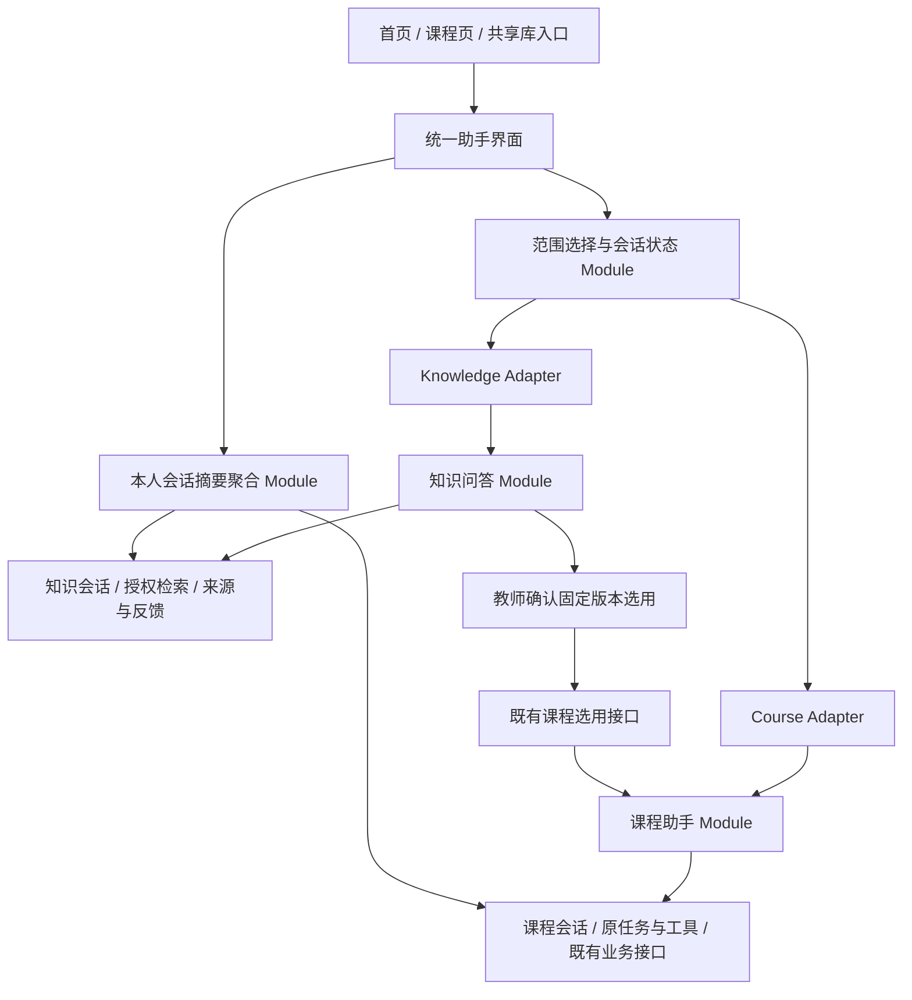

# PaperPact 首页统一 AI 助手方案

> 日期：2026-11-13。状态：设计稿，尚未实施、验证或发布。
> 已确定方向：统一首页入口与对话体验，覆盖现有课程助手和共享知识库问答；各领域继续独立处理数据、授权和业务操作。
> 本文用于产品与技术评审，不代表其中新增功能已完成，也不授权生产数据库变更或线上部署。

## 1. 产品定位与目标

将教师目前分散在课程内和共享库内的助手入口，统一为首页的「PaperPact AI 助手」。教师从一个输入框发起问题、恢复历史对话、查询课程状态、查找资料依据并推进命题流程。

教师不需要理解系统内部有两套助手，但每次回答使用的资料范围、每次操作作用的课程必须清晰可见。

本次设计解决三个问题：

1. 教师开始工作前，需要先判断应该进入课程还是共享库，入口分散。
2. 找共享资料、选用到课程、继续出卷之间缺少连贯引导。
3. 两类对话在会话恢复、输入体验、来源展示和页面跳转上存在差异。

成功标准是：教师能在统一入口完成两类助手现有任务，明确知道正在处理哪门课程或哪些共享库，且没有因合并入口出现越权、错误课程写入或历史串用。

## 2. 设计决策

| 方案 | 体验与成本 | 结论 |
| --- | --- | --- |
| 保持两个独立助手 | 复用成本最低，但教师仍需主动区分入口，跨流程跳转没有改善 | 不采用 |
| 合并为一个全域会话、统一工具和数据表 | 表面入口简单，但容易混淆资料来源、课程目标和可执行权限，迁移范围较大 | 不采用 |
| 一个首页、一个对话界面、统一历史入口，内部按目标调用课程或知识域 Module | 能覆盖已有能力，保留既有授权与业务路径，支持逐步演进 | 采用 |

统一的是产品体验与前端对话框架。课程 Module 和知识域 Module 继续拥有各自的会话、消息、检索与执行规则，分别由 Adapter 接入统一界面。首版不合并物理消息表，不把课程级 `course_id` 改成可空，也不新增可任意调用全部业务工具的总控 Agent。

「全功能覆盖」指现有两类助手的能力均可从统一界面使用。首版不承诺在同一轮中混合私有课程与共享库检索，也不承诺跨多门课程批量执行。

## 3. 当前基线与实际差异

以下结论来自 2026-11-13 的本地源码检查，不代表线上状态或真实模型验收结果。旧设计文档中的目标能力不直接作为已实现能力。

| 模块 | 当前本地实现 | 统一后的处理 |
| --- | --- | --- |
| 默认入口 | 登录与兜底路由进入 `/knowledge`，包含我的资料与校级共享库 | 增加 `/home`，作为教师默认入口，资源管理页面保留 |
| 课程助手 | `/courses/:courseId/assistant`；按课程隔离，多会话、SSE、停止回答、提案卡和出卷接力 | 在统一界面完整接入，保留原业务端点与授权 |
| 课程资料问答 | 课程内 RAG 问答，有来源卡 | 保留，只使用当前课程可用资料 |
| 共享库问答 | 空间问答页签与跨库问答弹窗；最多选择 5 个共享库 | 迁入统一界面，原入口携带范围打开同一助手 |
| 共享库回答方式 | `knowledge_answer_service.ask` 调用授权检索后拼接资料摘录，标记 `channel=extractive`；当前未调用回答模型 | 首版明确标为「资料摘录」；模型综合回答另列后续阶段 |
| 共享库会话 | 有本人会话列表、详情、提问、反馈；当前没有重命名和删除端点 | 补齐必要的会话管理，使统一历史入口可用 |
| 共享资料选用 | 固定版本选用到本人课程，已有许可、来源与版本关系 | 复用既有操作，增加进入课程助手的衔接 |
| 资料范围变化 | 当前知识域会静默排除部分无权空间 | 统一助手接入前补齐明确反馈，不能让界面显示范围与实际检索范围不一致 |

主要核对入口：

- [前端路由](../frontend/src/App.tsx)、[课程助手页面](../frontend/src/pages/assistant/index.tsx)、[课程助手状态](../frontend/src/stores/assistantStore.ts)。
- [知识中心](../frontend/src/pages/knowledge-center/index.tsx)、[共享空间详情](../frontend/src/pages/knowledge-center/SpacePage.tsx)。
- [课程助手接口](../backend/app/api/v1/assistant.py)、[工具注册表](../backend/app/services/assistant_tools.py)、[提案执行](../frontend/src/lib/assistantProposalExecution.ts)。
- [知识域接口](../backend/app/api/v1/knowledge_base.py)、[知识问答](../backend/app/services/knowledge_answer_service.py)、[知识检索](../backend/app/services/knowledge_search_service.py)。

## 4. 首页与入口设计

### 4.1 信息架构

教师侧顶层入口为「首页助手」「资料与知识中心」「课程命题」。后台管理仍按既有身份展示。

首页主体是可直接使用的助手工作区，包含新对话、历史会话、范围选择和输入框。保留最近课程与最近共享库的便捷入口，避免教师处理文件时必须先经过对话。

桌面端采用历史列表与对话区的两栏布局；手机端将历史列表和范围选择收进抽屉。沿用现有字体、颜色、按钮和间距规范，首页使用工作台布局，不新增宣传性大标题或装饰区。

空白首页提供四个快捷任务：

- 问课程资料。
- 问共享资料。
- 查看课程进度。
- 帮我推进出卷。

快捷任务只预填任务与推荐范围，不直接创建业务对象或执行操作。教师也可以直接输入问题。

### 4.2 范围栏

输入框附近始终显示当前范围：

- 课程会话：`当前课程：数据结构`；需要时补充本轮明确的试卷项目。
- 共享会话：`共享资料：算法教研库、教学案例库`，最多 5 个共享库。
- 尚未选择：`选择课程或共享资料`。

对话标题和历史条目同步显示课程或共享资料标识。共享资料摘录卡、课程查询卡与操作卡保持不同含义，不用同一种成功提示代替所有结果。

### 4.3 路由与旧入口

| 路由或入口 | 目标行为 |
| --- | --- |
| `/home` | 统一助手的新对话工作区 |
| `/assistant/course/:courseId/:sessionId` | 在相同界面恢复指定课程会话 |
| `/assistant/knowledge/:sessionId` | 在相同界面恢复指定共享会话 |
| `/courses/:courseId/assistant` | 兼容入口，校验后打开该课程最近会话或未发送草稿，不重复创建空会话 |
| 课程页「AI 助手」 | 携带当前课程打开统一助手 |
| 共享空间「问答」 | 携带当前空间打开统一助手；已有同范围会话可供恢复 |
| 知识中心「跨库问答」 | 选择共享库后打开同一助手，替代独立问答弹窗 |
| 共享问答旧页签深链 | 保留可识别入口并跳转，不使既有链接失效 |

登录后没有待恢复的合法业务深链时进入 `/home`；有深链时优先恢复原目标。`/knowledge` 与 `/courses/**` 的资源管理和课程生产线继续可直接访问。

范围与会话 ID 可以出现在 URL 中，问题正文、回答正文和资料摘录不放进 URL。刷新恢复依赖服务端会话，不依赖页面临时状态。

## 5. 场景分流与会话规则

### 5.1 先确定目标，再处理任务

分流次序为：用户明确选择的范围、当前已绑定会话、来源页面携带且经服务端校验的范围。没有有效目标时先选择。

教师在首页直接输入「帮我出一份期末卷」时，系统保留问题并展示本人课程供选择；选择后再发送。不能默认使用列表第一门课程，也不能用上次浏览的课程悄悄开始写操作。明确提到课程名称时可以推荐候选，但教师需确认目标；重名课程显示必要的区分信息。

选择共享资料后，问答只访问所选且当前可读的空间。模型可以判断该领域内部的任务意图，不能决定教师拥有哪些权限或擅自扩大检索范围。

首页选择器只展示「我的课程」和「共享资料」，不要求教师先了解两个内部助手名称。

### 5.2 一个会话绑定一个范围

| 会话类型 | 固定范围 | 修改规则 |
| --- | --- | --- |
| 课程 | 一门本人拥有的课程 | 换课程时打开该课程已有会话或新建会话 |
| 共享资料 | 同校内明确选定的 1 至 5 个共享库 | 更换库集合时新开会话；重新排序不算范围变更 |
| 未绑定草稿 | 尚无服务端会话 | 可自由选择目标，首条消息发送前完成绑定 |

首版不建立无范围的长期聊天会话。每轮可缩小到当前范围内的某份资料或项目，但不得超出会话范围；只有领域接口明确支持的筛选条件才生效。

切换范围时保留尚未发送的输入，由教师发送到新目标。旧历史保持原归属，不复制为新会话的隐藏上下文，不自动把旧提问提交给新目标。

历史列表统一展示与筛选，模型上下文仍只来自当前原生会话。统一列表本身不会把所有历史拼接给模型。

### 5.3 在途与恢复

- 切换会话只改变正在查看的对话。课程任务继续按原目标运行，原会话显示在途状态，切回后恢复。
- 「停止回答」只取消当前课程助手轮次；它不代表已经取消发起的整卷生成、资料解析等业务任务。
- 共享问答目前为同步请求。首版不能把关闭页面或中断 HTTP 等待显示成「任务已取消」，界面按实际能力提供操作。
- 统一界面首版只允许一个前台提交中的助手轮次；课程已派发的业务任务可继续后台运行。跨标签页的任务状态以服务端为准。
- 切走后仍能看到原会话的在途标识。所有异步返回按原领域、目标、会话与请求绑定写回，不能覆盖当前正在查看的另一会话；后返回的旧范围查询不能覆盖新范围选择。
- 自动执行沿用既有认领、回执与接力规则。加载全部历史、重新渲染卡片或切换页面不能触发跨会话批量执行。
- 执行结果未知时先查询原业务状态，不能因网络重试自动重放可能产生重复业务对象的操作。

## 6. 功能覆盖与执行规则

### 6.1 必须保留的能力

| 能力 | 统一界面行为 | 执行规则 |
| --- | --- | --- |
| 使用引导 | 展示能力、课程当前阶段和下一步入口 | 无课程时使用静态引导；课程进度必须绑定课程后查询 |
| 课程状态查询 | 资料、框架、蓝图、合同、项目及试卷状态卡 | 复用 `course_overview`，继续区分计划题位与实际成卷数据 |
| 课程资料问答 | 回答与原课程来源卡 | 复用课程 RAG，仅当前课程 |
| 课程创建、更新、发起解析 | 提案、影响说明、确认和回执 | `create_course`、`update_course`、`start_parse` 继续显式确认 |
| 出卷主线 | 建项目、改规则、建蓝图、蓝图建议、确认蓝图、确认合同、发起生成 | 保留现有工具与接力，`confirm_blueprint`、`confirm_contract` 继续显式确认 |
| 框架及整卷评审、题型格式调整 | 原有卡片、进度、结果页面跳转 | 保留现有执行策略 |
| 单库、跨库资料问答 | 同一个输入框，返回资料摘录、版本引用与证据不足状态 | 最多 5 个授权共享库，只读 |
| 共享问答反馈 | 对当前本人回答提交反馈 | 延续知识域接口与隐私规则 |
| 共享资料选用到课程 | 来源卡进入资料选用流程，再进入课程助手 | 固定版本、双边权限和显式确认 |
| 历史管理 | 统一列表、恢复、新建、重命名与删除 | 分别落到原生会话，不迁移消息 |

当前工具注册表中有 5 个显式确认工具，其余课程提案保留注册表定义的自动执行策略。首页统一不将所有写操作改为确认制，也不移除既有确认。工具数与策略以注册表为准，不在新界面复制另一份规则表。

从无课程首页创建课程使用已有课程创建表单和业务接口，成功后建立新课程会话。已绑定课程会话内的 `create_course` 继续可用，成功后提供进入新课程的操作，不把旧会话原地改绑。

试卷定稿、导出、资料删除继续跳转既有业务页面；共享库发布、撤回、成员与共享范围修改继续由管理页面执行。在线考试和在线阅卷继续处于产品范围之外。

### 6.2 操作卡要求

所有会产生业务变化的卡片显示作用课程、项目或资料及影响说明。提案执行使用卡片绑定的原始目标，不能读取此刻全局选择器的值替代目标。

服务端在既有业务入口再次校验身份、归属、当前版本和业务状态。卡片生成后课程被删除、权限发生变化或目标已冻结时，返回明确的不可执行状态；不能将旧提案应用到另一课程或新版本。

自动执行卡同样显示正在做什么及最终回执。自动步骤失败后停止对应接力，保留已完成步骤，不把部分成功描述为整条出卷流程完成。

## 7. 共享资料到课程命题的衔接

示例：教师在共享库查找动态规划教学资料，然后选用到算法课程继续命题。

1. 教师在首页选择相关共享库并提问。
2. 助手展示资料摘录或后续模型回答，并提供固定版本的来源卡。
3. 教师从来源卡打开资料选用面板，检查原文、版本、选用许可及目标课程。
4. 点击「确认选用」后调用既有 `import-to-course` 接口；本轮仅支持逐份确认，避免引入新的批量事务语义。
5. 成功后显示实际回执：新增副本、追加新版、返回已有副本或定位源资料。遇到本地修改冲突则保留冲突状态并引导处理。
6. 提供「到课程助手继续」操作，打开目标课程会话。只传递经服务端确认的目标课程、资料版本关系与选用结果，不复制共享问答正文为模型记忆。
7. 课程助手重新读取目标课程状态，检查解析、命题框架与知识目录是否就绪，再按原生产线推进。

资料被选用不等于已经纳入可用知识目录，也不等于可以立即生成试卷。无法选用时可以继续阅读有权资料，但不能把回答文本或共享片段直接绕过导入、框架、目录和合同交给生成流程。

来源撤回或选用许可关闭后，后续选用按现有规则拒绝；此前已经合法形成的课程固定版本副本依既有规则保留。共享来源权限与课程副本权限分别判断，来源页不可读不自动删除本人课程副本。

## 8. 技术设计

### 8.1 Module 与 Adapter

统一界面的 Interface 包含目标、会话、消息视图、支持的操作和真实任务状态。两个 Adapter 隐藏原生端点、消息形状及传输差异。授权判定与业务写入仍在既有领域入口，不在 Adapter 中复制。

### 8.2 前端组织

| 位置（拟定） | 职责 |
| --- | --- |
| `pages/home/` | 首页未绑定状态、快捷任务与最近目标 |
| `components/assistant/` | 对话壳、输入框、范围选择器、历史列表和卡片组合；逐步提取现有助手 UI |
| `lib/assistant/adapters/` | Course 与 Knowledge Adapter，标准化视图和能力声明 |
| `stores/unifiedAssistant.ts` | 当前会话定位、草稿、摘要列表、加载与范围切换；不保存第二份原生消息真相 |
| `stores/assistantStore.ts` | 保留课程消息、SSE、执行回执与出卷接力，按需调整绑定方式 |
| `stores/knowledgeConversation.ts`（拟定） | 从弹窗和空间页提取共享会话逻辑，调用既有知识域客户端 |

客户端使用带判别字段的会话引用，例如课程 `{domain, courseId, sessionId}` 与共享 `{domain, sessionId}`。共享库集合由服务端会话详情返回。缓存和任务标识必须包含领域与原生目标，不能只用 `sessionId` 或 `projectId`。

视图保留原始消息标识与所属领域，以便回写提案、反馈和来源定位。正文、引用、依赖版本与执行状态不得因标准化而丢失。界面按 Adapter 的能力声明展示取消、反馈等操作，不伪造另一个领域没有的能力。

首版避免重写课程执行队列、SSE 解析器和卡片执行分支，继续复用 `assistantProposalExecution.ts`。全局课程选择、页面 `courseId` 与任务绑定目标不再互相代替。

### 8.3 会话摘要聚合

首页需要跨课程和知识域的本人历史，不能通过逐门课程请求会话列表形成随课程数增长的请求瀑布。

拟增加只读摘要入口：`GET /api/v1/assistant/sessions`，支持领域筛选、课程筛选和有上限的游标分页。它调用领域内的本人会话查询，只返回标题、领域、可展示的目标名称、原生会话引用和更新时间，不聚合消息正文。

实现要求：

- 课程会话通过当前用户拥有的课程集合限制；知识会话通过本人、当前学校与有效会话状态限制。管理员身份不扩大结果。
- 课程筛选必须同时做本人课程授权；非法范围不能成为查询其他教师会话的通道。
- 排序采用 `updated_at` 加领域及原生 ID 的稳定次序。游标不携带正文，旧客户端继续使用原列表接口。
- 目标失效后不返回失权资源名称、标题或正文；直接打开旧链接时显示范围不可用状态。
- 摘要不是授权凭证，打开详情、发送、反馈和执行时仍由原生入口重新授权。

不为统一列表新建全局消息表或持久化副本。需要新增的本人摘要查询应留在对应领域 Module 内，再由聚合入口组合。

### 8.4 原生接口与补齐项

课程轮次仍走 `/courses/{course_id}/assistant/**`，共享会话仍走 `/knowledge/sessions/**`。首版不新增另一套通用写操作入口。

为统一体验补齐知识域 `PATCH /knowledge/sessions/{id}` 和 `DELETE /knowledge/sessions/{id}`：重命名仅允许本人会话；删除使用已有 `status=deleted` 状态，后续详情、提问和反馈均不可访问。界面说明这是删除本人对话，不影响共享资料。消息物理清理按后续明确的保留策略处理，不声称即时物理删除。

删除与同步提问并发时，需要在服务端落结果和返回前复核会话仍有效：已删除会话不因迟到写入恢复，也不继续向浏览器返回答案。课程会话删除保留既有在途 `409` 规则；P2 引入知识域异步轮次后，再按其任务状态补齐取消与删除协调。仅在当前页面禁用删除按钮不能代替服务端处理。

共享库创建与提问需校验完整选定集合。部分范围失效时返回结构化的范围变更状态，不继续静默缩小检索后给出看似完整的回答。前端只展示当前仍可读的名称，并让教师用剩余范围创建新会话；不能扩展到全部可访问库。

上述授权继续调用 `require_space_access` 与其背后的 `policies.py`，不在新路由重写权限矩阵。原始课程表、知识表和任务域保持独立，首版预计无需新增表；若细化实现发现结构变更，必须单独列出并通过既有初始化迁移路径处理。

## 9. 权限、来源与异常状态

| 状态 | 产品反馈与处理 |
| --- | --- |
| 没有本人课程 | 保留共享问答可用入口，并提供创建课程；不以他人课程或占位课程兜底 |
| 无学校归属或无共享库权限 | 说明共享资料范围不可用，课程能力按自身授权继续可用 |
| 空库、尚未发布、索引未就绪 | 展示实际状态，保持所选范围；不能自动转到其他资料回答 |
| 未检索到足够证据 | 明确说明证据不足；不把通用模型知识伪装为当前资料结论 |
| 库权限、账号组织或资料状态变化 | 提问与历史读取重新校验；受影响答案正文与全部引用整体隐藏，不能只删链接留下正文 |
| 课程资料与共享资料结论不同 | 首版各自在对应会话回答，显式显示来源；不自动合并成一个无出处结论 |
| 网络失败或执行回执未知 | 保留教师输入，提供刷新原状态或重试入口；不自动重复非幂等写操作 |
| 课程提案已过期 | 显示不可执行及原因，允许重新根据当前状态生成提案 |

会话仅本人可读；空间 owner 与管理员不因此获得他人私人问答。共享来源保留空间、文档、固定版本及页码或章节定位；来源打开前再授权，不返回私有源课程的 ID 或链接。

服务端决定 actor、学校、有效课程和可读空间。浏览器选择、URL 参数、上传资料中的指令及模型输出都不能作为授权结论。

用户退出、账号变化或获知权限撤销时清理相关内存视图。浏览器只持久化必要的会话引用与非敏感偏好，不新增回答正文和资料摘录的本地持久缓存。前端已经展示的内容无法保证被远程收回，这不作为可撤销共享的承诺。

## 10. 分阶段实施

### P0：核对与保护既有行为

产物：功能映射、真实端点清单、原工具执行策略、旧链接兼容清单，以及课程和知识域授权用例。确认现有页面、卡片、输入、历史和移动端需要复用的部分。

完成条件：能够逐项说明原课程助手与共享问答如何接入，无遗漏能力，也没有把摘录式回答描述为已完成模型问答。

### P1：统一入口，覆盖现有能力

1. 提取对话壳、消息视图、输入框和范围选择，接入两个 Adapter。
2. 增加本人历史摘要聚合与共享会话重命名、删除，补齐完整范围校验及失效反馈。
3. 接入课程全部现有卡片、SSE、停止回答、自动执行、接力和生成进度。
4. 接入共享单库、跨库摘录问答、版本来源与反馈，替换分散的独立问答界面。
5. 增加来源卡到既有资料选用面板、再到目标课程助手的衔接。
6. 兼容旧入口并完成回归；完成后再切换默认首页。

完成条件：教师能从同一首页和对话界面完成现有两类助手任务，执行范围明确，历史与权限隔离正确。P1 作为首个可发布版本，不以模型问答升级为前提。

### P2：共享库模型综合回答

在 P1 稳定后，按知识库既有设计接入回答模型。检索范围、来源白名单、证据不足状态、依赖版本及授权复核继续由服务端控制。

模型调用通过现有模型网关，在 Celery 与知识域任务/outbox 中执行，不加入同步 `ask` 请求线程。状态流可先传处理阶段，最终答案在验证与授权复核后返回；不为了模仿课程流式文本而提前输出尚未复核的共享正文。

补齐同会话幂等、取消、超时、租约与迟到结果处理后再开放相关按钮。模型失败时可明确降级为「资料摘录」，不能仍标注为模型综合回答。评估检索与回答质量后再确定可用范围，不把课程 RAG 已验证结果当作知识域评测结果。

### P3：按实际需求评估混合只读问答

若教师确实需要将一门课程资料与若干共享库进行对照，再设计明确授权、单独绑定范围的混合只读会话。它不继承课程写工具，不把共享片段绕过选用流程用于命题。

跨多课程执行、全校资料自动搜索和全域长期记忆不纳入本轮交付，不预建相关空表或工作流。

## 11. 验收与验证

以下是实施后的验收要求，不是已完成测试记录。

| 编号 | 验收场景 | 通过标准 |
| --- | --- | --- |
| A01 | 登录与旧入口 | 默认进入首页；合法深链、旧课程助手链接和共享问答入口均可恢复目标 |
| A02 | 首页无目标直接提问 | 输入保留，先选择范围；未选择前零模型调用、零业务写入 |
| A03 | 全能力覆盖 | 第 6 节课程工具与两类共享问答逐项可用，确认与自动执行策略无变化 |
| A04 | 目标与历史隔离 | 课程 A 切到 B、共享库集合改变后，新请求不携带原会话消息与来源 |
| A05 | 课程授权 | 教师不能通过历史列表、旧链接、SSE 或提案执行访问他人课程 |
| A06 | 知识域授权 | 不能跨校或跨无权空间读取；部分撤权时明确阻断并重新选范围 |
| A07 | 历史再授权 | 已依赖撤回或失权资料的答案整体隐藏，不从前端持久缓存恢复正文 |
| A08 | 提案目标稳定 | 卡片生成后切课程或切会话，执行仍只作用原目标；失效提案拒绝执行 |
| A09 | 自动执行可靠性 | 刷新、切换和双击不会产生重复执行；部分失败停止接力且保留真实回执 |
| A10 | 在途恢复 | 切走后任务和迟到响应仍归属原会话，不覆盖当前视图；停止回答不会错误标注已取消整卷生成 |
| A11 | 来源到课程 | 选用经过确认，固定版本和来源关系正确；本地修改冲突、重复选用及源撤回按原规则处理 |
| A12 | 成卷口径 | 查询实际题数和总分读成卷状态，不能使用蓝图计划数替代 |
| A13 | 会话管理 | 两类会话均可新建、恢复、重命名与删除；跨用户不可操作，删除不影响资料，迟到提问结果不使已删除会话恢复 |
| A14 | 首屏与失败状态 | 历史分页不逐课程发请求；知识域失败不会阻断课程侧，空态及错误可恢复 |
| A15 | 桌面与手机 | 在常用桌面宽度及约 390px 手机宽度下输入、范围、历史与卡片操作无横向溢出或遮挡 |

后端复用并扩展课程助手、课程访问矩阵、知识空间/生命周期与课程桥接测试，增加摘要聚合、完整范围校验和会话管理的接口测试。前端沿用 `npm run build` 与 `npm run lint`，不新增单元测试框架；使用浏览器验证关键操作与布局。

测试使用隔离数据与可控外部 Adapter，避免把真实教师私有材料作为调试样本。涉及领域引擎的既有回归按项目规范执行；本方案无需修改已封存的三个工作流。

上线前记录通过与未通过项目；本地 SQLite 验证不替代 PostgreSQL、Redis、真实异步任务与恢复检查。P2 需另行保存回答质量、撤权、取消、失败降级和模型调用成本的实际验证记录。

## 12. 发布与后续文档同步

实施采用可回退的助手首页开关，分离「新入口可见」与「默认入口切换」。先确保两类能力与兼容入口可用，再切换登录默认地址。回退时恢复原默认入口和旧页面，原生会话、任务与消息无需逆向迁移。

首版保留原端点，统一界面不做历史批量搬迁。更改现有文件前按项目习惯保留备份；版本控制中的用户未提交改动独立保留。生产部署与数据库升级按项目既有流程执行，不由本设计稿自动触发。

仅新增或复用业务所需的观测字段：领域、目标引用、任务 ID、操作类型、耗时和失败分类；跨领域统计不收集问答正文。新入口是否降低操作成本，需要上线后用实际任务完成情况与教师反馈验证，不预设提升百分比。

实施完成后同步相关文档：

- [共享知识库设计](CAMPUS_KNOWLEDGE_BASE_DESIGN.md)：更新独立问答入口的表述，保留知识域只读、授权和来源规则。
- [资料与课程整合](RESOURCE_CENTER_INTEGRATION.md)：更新默认首页与问答入口，保留资源管理和版本选用流程。
- [后端接口](backend-api.md)：记录摘要聚合、会话管理及范围变化响应。
- [交接文档](HANDOVER.md)：说明首页路由、Adapter、原生状态与回退方式。

文档表述与代码存在差异时，以本次核对的实际实现及项目核心纪律为基线；未来实施中对本方案的调整应记录原因与新的验收条件。
